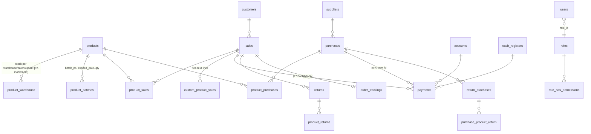

# Red Pharma: Database Dependencies

Source: production dump `u241572975_redpharma_app.sql` (2026-03-10, MariaDB 11.8.3), 207 migrations and 104 models. Full evidence with `file:line` and the complete 94-table inventory: `workpapers/wp3-database.md`. This document contains schema facts and aggregate counts only; it has **no personal data**.

---

## 1. Headline facts

| Fact | Value |
|---|---|
| Tables | 94 (56 with data, 38 empty) |
| Declared foreign keys | **8**, none on the sales, purchase or payment chain |
| Indexes on hot tables | **None** on `sales`, `product_sales`, `payments`, `purchases`, `product_purchases`, `returns`, `product_batches` |
| Largest tables | product_sales ≈302k · payments ≈122k · sales ≈120k · product_purchases ≈65k · product_warehouse ≈36k · products ≈24.5k |
| In use | 1 warehouse, 1 account, 1 currency, unit `Pc` only, all payments `Cash` |
| Migrations vs prod | 13 prod tables have no migration file. 6 2026 migrations (membership, rewards, AI, customer auth) are **not applied**. **Migrations cannot rebuild prod; the dump schema is the source of truth** |

## 2. Domain map (core)

Online orders are `sales` rows with `sale_type='website'` and `sale_status=0`; they have no separate table. Payments are polymorphic by nullable column: each row has `sale_id` XOR `purchase_id`, and the data confirms this holds.

## 3. Stock model (business-critical)

| Store | Grain | Notes |
|---|---|---|
| `products.qty` | total per product (base units) | denormalised |
| `product_warehouse.qty` | product × warehouse × batch × variant | **11,568 duplicated keys** (11,923 surplus rows). Lookups use `->first()`, so sales decrement an arbitrary row |
| `product_batches.qty` | product × batch_no (warehouse-agnostic) | only 11 rows, all expired. **0 sale lines carry a batch** |
| `product_variants.qty` | product × variant | unused (0 rows) |

- **There is no stock movement ledger.** History can only be rebuilt by replaying line tables.
- Drift: `products.qty ≠ Σ product_warehouse.qty` for **2,591 products**, and 26 products are negative even though `without_stock='no'`.
- **Expiry:** `product_batches.expired_date` and a parallel `products.expire_date` exist. The latter is set on 3 products, and the Excel import writes it as 2999-12-31. **No FEFO and no expiry blocking happen in practice.**
- **Units:** `units.operator` and `operation_value` convert entered qty to base qty. In practice everything is in pieces.
- **Pack fields** `products.box_qty/stripe_qty/piece_qty` (pharmacy-specific, not in migrations) are used only by the reorder and AI draft logic, never by stock movement.

## 4. Money model

- All money columns are `double`.
- Sale header totals (`total_price`, `order_tax`, `order_discount`, `coupon_discount`, `shipping_cost`, `grand_total`) are **stored as sent by the browser**.
- `sales.paid_amount` is stored and incremented. It mismatches Σ payments on 64 sales; 212 sales have no payment.
- Status codes are magic ints:
  - `payment_status`: 1 Pending, 2 Due, 3 Partial, 4 Paid.
  - `sale_status`: 1 Completed, 2 Pending, 3 Draft, 4 Returned, 5 Processing, 0 web.
  - Purchase `payment_status`: 1 Due, 2 Paid.
- Customer due is **derived on read**, with inconsistent formulas across reports (some omit returns).
- Supplier due is `grand_total − paid_amount`.
- `customers.deposit/expense` are running totals.
- Legacy loyalty is `customers.points` (373 customers have points). The new `reward_wallets` engine is a second ledger with **no opening-balance migration**.
- Reference numbers use `date('Ymd-his')` (12-hour clock), producing **511 duplicate sale refs and 508 duplicate payment refs**.
- 2,397 payments have `account_id=0`. 64% of payments have no `cash_register_id`.

## 5. Business-critical dependencies (do not break)

1. Sale path write order: `sales` → `product_sales`/`custom_product_sales` → `products.qty`, `product_warehouse.qty`, (`product_batches.qty`) → `payments` → `customers.points/expense`, `gift_cards.expense`. Not transactional today.
2. Unit conversion semantics (`units.operator/operation_value`) define the meaning of historical lines. Never edit existing unit rows.
3. One `product_warehouse` row per key is assumed by the code but not true in the data.
4. Due calculations depend on `grand_total`, `paid_amount` and `returns.grand_total`, and on `payments.amount` excluding `change`.
5. Status integer codes are hard-coded across controllers and Blade.
6. Customer logins (`customers.password`, Sanctum tokens) are live for the website and app.
7. `general_settings.without_stock` gates POS product availability.
8. The AI reorder flow reads `product_sales`, `product_warehouse` and the pack fields, and writes `product_order_quantitys`.
9. Destructive cascades: `product_warehouse → products ON DELETE CASCADE`, `order_trackings → sales CASCADE`.
10. Hard deletes of sales, purchases, returns and payments; no `deleted_at` anywhere. 643 sale lines and 219 purchase lines point at hard-deleted products.

## 6. Rules for schema changes in this project

1. **Add-only.** Never drop, rename or retype existing columns or tables. Guard with `Schema::hasTable/hasColumn`.
2. **Baseline first.** Create a schema-dump baseline from a prod clone so staging and CI match prod. Add `if (!hasTable)` migrations for the 13 hand-made tables.
3. **Clean data, then constrain:** dedupe `product_warehouse` (with an audit copy) → index → unique (generated `COALESCE` columns for nullable keys). Reconcile `products.qty` with a logged report. Re-key duplicate references by suffix only.
4. **Indexes first (online, `ALGORITHM=INPLACE, LOCK=NONE`):** product_sales(sale_id), product_sales(product_id, created_at), payments(sale_id), payments(purchase_id), sales(customer_id), sales(created_at), sales(reference_no), product_purchases(purchase_id), product_returns(return_id), returns(sale_id), product_warehouse(product_id, warehouse_id), UNIQUE products(code) (0 duplicates), UNIQUE product_batches(product_id, batch_no).
5. **FKs later, RESTRICT not CASCADE,** after aligning `int(11)` signed and `int(10) unsigned` types and resolving orphans.
6. **No hard deletes of financial or stock rows.** Add `deleted_at`/void status before changing delete behaviour.
7. **New tables needed by the target design (add-only):** `stock_movements` (ledger), `idempotency_keys`, `audit_logs`; later, optional shadow `decimal` money columns.
8. **Pending 2026 migrations:** dry-run on a prod clone first. Write a `customers.points` → `reward_wallets` opening-balance migration before enabling the reward engine.
9. Every migration needs a working `down()`, before/after row counts and checksums on sales, product_sales, payments and product_warehouse, a backup, and a low-traffic window, **with your approval for production**.
