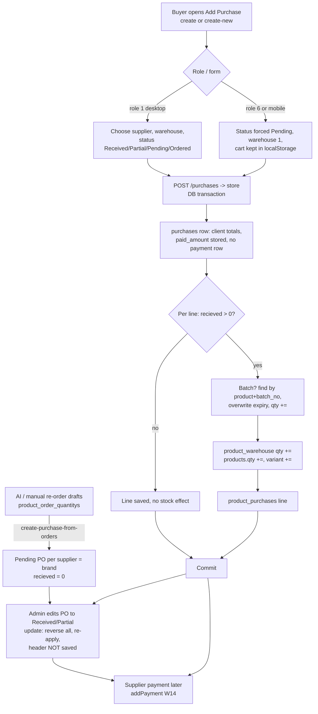
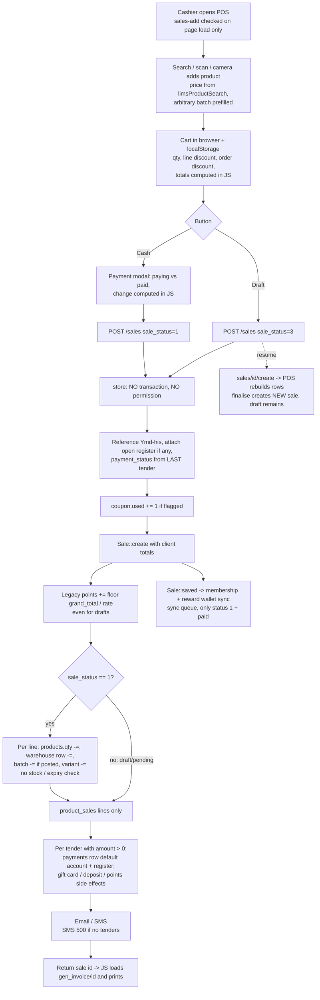
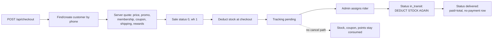

# Red Pharma POS: Business Workflows (As-Is)

**System:** Red Pharma POS, a legacy Laravel 10.48.29 Blade application derived from SalePro.
**Codebase traced (read-only):** `D:\01 REDPHARMA\00 CODEBASE\backend - ocr pos\`. Every `file:line` below is relative to that folder.

**Sources:**
- WP5 `workpapers/wp5-workflows-security.md` (primary)
- WP1 `wp1-navigation-core.md`
- WP2 `wp2-navigation-admin.md`
- WP3 `wp3-database.md` (production DB dump dated 2026-03-10)
- WP4 `wp4-api-consumers.md`
- Defects are cross-referenced to `known-issues.md` (KI-nnn).

**Date:** 2026-11-23

**Purpose:** record the business workflows that exist today, so that the new system preserves the real business rules and deliberately fixes the defective behaviour. This document only describes what exists in code or data. It is not a target design.

**Tags:**
- **[V]**: verified in the local source.
- **[U]**: unverified (depends on production code, config, cron or front-end runtime).
- **[DATA]**: evidence from the 2026-03-10 production dump. Counts only; no PII.

> **Production caveat.** The production source is not in the workspace (KI-017).
> - Live `/pos` returns 302 to login, while `/report/pos` returns 404. Both local snapshots register the POS only at `/report/pos`.
> - Line numbers and route paths below describe the local snapshot `backend - ocr pos`. Production behaviour must be re-confirmed before any rule is treated as final.
> - The storefront API is currently **not** served on the live POS host (KI-002).

---

## 0. Shared reference

### 0.1 Status codes (hard-coded integers)

| Field | Values |
|---|---|
| `sales.sale_status` | 0 = pending web order; 1 = completed; 2 = pending; 3 = draft/hold; 4 = returned; 5 = processing (packing slip created) |
| `sales.payment_status` | 0 = web order (unpaid); 1 = pending; 2 = due; 3 = partial (never set by the POS); 4 = paid |
| `purchases.status` | 1 = received; 2 = partial; 3 = pending; 4 = ordered |
| `purchases.payment_status` | 1 = due; 2 = paid |
| `transfers.status` | 1 = completed; 2 = pending; 3 = sent |
| `deliveries.status` | 1 = packing; 2 = delivering; 3 = delivered |
| `order_trackings.current_status` | free string: pending, processing, assigned, in_transit, delivered |
| `sales.sale_type` | pos, website, manual |

### 0.2 Where stock and money live

- **Stock** is held in four places, all updated by hand in PHP (read, modify, write), with no ledger and no locks:
  - `products.qty`: global total, in base units.
  - `product_warehouse.qty`: per product × warehouse × batch × variant.
  - `product_batches.qty`: per product × batch number, the same for every warehouse.
  - `product_variants.qty`: per variant.

  The only history is the documents themselves: sales, purchases, returns, adjustments and transfers (KI-035).
- **Unit conversion:** base qty = qty × `operation_value` when `units.operator='*'`, or qty ÷ `operation_value` when it is `'/'`. The unit is looked up by **unit name** (for example `SaleController.php:1459`).
- **Money:**
  - Header totals are stored on `sales` and `purchases`.
  - Payments are stored in `payments` (each row has either `sale_id` or `purchase_id`).
  - Refunds exist only as `returns.grand_total` plus `account_id`. No payment row is written.
  - Account balances are computed on read; `accounts.total_balance` is stale.
  - Money columns are `double`.

### 0.3 What production actually uses [DATA]

The code supports far more than the business uses. As of 2026-03-10:

| Area | Usage |
|---|---|
| Warehouses / accounts / currencies | 1 warehouse, 1 account, 1 currency |
| Payments | 121,748 payments, all `paying_method='Cash'` |
| Units | all products in unit `Pc` |
| Batches | 11 batch rows, all expired; **0 sale lines carry a batch** |
| Not used at all | variants, combo products, transfers, gift cards, coupons, deposits, money transfers, quotations, packing slips, challans, deliveries |
| Volumes | 119.5k sales, 302k sale lines, 8.5k purchases, 2,080 sale returns, 5 purchase returns, 30 adjustments, 5 stock counts (none adjusted), 27 web orders, 3 cash registers (all open) |
| Membership / reward wallets / AI-run tables | **not yet migrated in production** (KI-034) |

Several workflows below therefore exist in code but carry no production data. They are marked "unused in production".

### 0.4 Cross-cutting controls (applies to every workflow unless stated)

| Workflow | DB transaction | Idempotency | Row locks | Server-side pricing | Server-side permission on write |
|---|---|---|---|---|---|
| Product create / edit / import | No | No | No | n/a | No |
| Purchase store / edit / import | **Yes** | No | No | No (import: yes) | No |
| Purchase payment / delete / return | No | No | No | No | No (`destroy` only) |
| POS / form sale store | **No (commented out)** | No | No | **No** | No |
| Sale edit / delete / payment | No | No | No | No | No |
| Sale return | No | No | No | No | No |
| Adjustment / transfer / stock count | No | No | No | n/a | No |
| Cash register, deposits, clear-due, money transfer, expense | No | No | No | n/a | No |
| Web checkout (API) | **Yes** | No | Coupon only | **Yes** | public |
| Online order status | No | **No** | No | n/a | No |
| Membership / reward services | **Yes** | **Yes** | **Yes** | **Yes** | any staff user |
| AI draft generation | **Yes** | run mutex | **Yes** | n/a | **Yes** |

All web routes share only `['common','auth','active']` (`routes/web.php:140`). Permission checks run on the `index`, `create` and `edit` GET pages, which hides menus. **Writes are almost never checked server-side (KI-011).**

---

## W1. Product creation, edit, import

**Trigger / screens:**
- Product → Add Product: `GET /products/create` → `ProductController@create` (`:400`).
- Product → Product List: `GET /products` (`:125`).
- Import Product, Bulk Update and Download Bulk buttons on the product list.

**Actors and permissions:**
- Pages are gated by `products-index`, `products-add` and `products-edit`.
- `store` (`:419`), `updateProduct` (`:1004`), `importProduct` (`:1276`), `bulkUpdateproduct` (`:1602`) and `destroy` (`:1896`) check **nothing** (KI-011).

### W1.1 Create: steps

| # | Step | file:line | DB writes |
|---|---|---|---|
| 1 | Validate `code` and `name` (unique among active products, max 255). Price, cost, unit, category and the flags are not validated | `ProductController.php:421-434` | — |
| 2 | Build `$data` from the request. HTML-escape the name and turn `\n` into ` `. Replace `"` with `@` in details | `:437-438` | — |
| 3 | Force `is_active=1`, `featured=1`, and image `zummXD2dvAtI.png`. The uploaded image is discarded | `:441` | — |
| 4 | Set pharmacy fields: product-level `expire_date`, plus `box_qty`, `stripe_qty`, `piece_qty` (KI-097) | `:440, 445-447` | — |
| 5 | `Product::create($data)`: mass assignment that includes `qty`, `cost` and `price` | `:449` | `products` |
| 6 | For each `stock_warehouse_id[]` with stock > 0, `autoPurchase()` creates an opening-stock purchase | `:472-551` | `purchases` (status 1, payment_status 2, paid = total), `product_purchases` (`recieved = qty`), `product_warehouse` (+qty or new row), `payments` (Cash, **`account_id = 0`**) |
| 7 | `products.qty += Σ stock`. Clear caches | `:462-465` | `products.qty` |

- **Stock math:** opening stock = Σ entered stock per warehouse. No batch row is created, even when `is_batch` is set.
- **Money math:** opening stock is booked as a paid purchase at `products.cost` (± tax), paid in cash from a non-existent account 0. [DATA] There are 2,397 such payments (KI-073).

### W1.2 Edit (`updateProduct`, `:1004-1066`)

1. Same weak validation. `update($request->except('image','file','prev_img'))` applies mass assignment.
2. For each posted warehouse, `product_warehouse.qty = stock`. This is an **overwrite**, not a delta (`:1041-1051`).
3. `products.qty = $initial_stock`, the **last** warehouse's value, or 0 if no warehouse is posted (`:1053-1056`). The form shows the qty of an arbitrary `product_warehouse` row (`edit.blade.php:251-260`). (KI-043)
4. `expire_date` is posted empty (`edit.blade.php:240`), so **every save nulls the expiry** (KI-044).
5. No adjustment document and no audit row.

### W1.3 CSV import (`importProduct`, `:1276-1392`)

1. Checks only that a CSV is present. Brand and category are created with `firstOrCreate`; the unit must already exist.
2. The product is matched by **name** (`firstOrNew`, `:1337`). Then `qty => 0` (`:1354`) and `expire_date => '2999-12-31'` (`:1358`).
3. `Product_Warehouse::insert(warehouse 1, qty 0)` runs on every row, every time (`:1376-1380`). This creates duplicates (KI-036, KI-045).
4. No transaction. A failed row leaves the file partially applied.

### W1.4 Other product operations

- **Bulk update** (`:1602-1676`, transactional): updates box/strip/piece and cost by code. No audit.
- **Download** (`:1681-1755`): a GET export of cost and profit with no permission check. It applies the 2025-07-08 filter hack (KI-070, KI-086).
- **Delete:** soft deactivate (`is_active=0`). No check for stock or open documents.
- **Category delete** deactivates every product in the category (KI-094).

### W1: assessment

- **Validation:** code/name uniqueness only.
- **Transaction / idempotency:** none; a re-submit creates a second opening purchase.

**Known defects:** KI-011, KI-036, KI-043, KI-044, KI-045, KI-073, KI-094, KI-096, KI-097.

**Rules the new system must preserve:**
- Product code is unique. [DATA] 0 duplicates exist, so `UNIQUE(code)` is safe.
- Products have cost, price, wholesale price, alert quantity, category and brand. Brand acts as the manufacturer.
- Pack sizes are box → strip → piece. The AI order logic uses `stripe_qty` and `piece_qty` to convert boxes to pieces.
- Opening stock creates a traceable stock-in document.
- Deleting a product deactivates it rather than erasing it.

**Behaviour to fix (needs business confirmation):**
- Remove stock editing from the product form; use adjustment only.
- Opening stock: should it be a "stock opening" movement instead of a paid cash purchase from account 0?
- Import should match on code and never reset stock or invent an expiry.
- Add medicine fields (generic name, strength, form, rack, schedule). Allow the same name in different strengths.
- Category delete should not silently deactivate products.
- Decide whether product-level `expire_date` survives at all, or whether expiry is batch-only.

---

## W2. Purchase and stock entry

**Trigger / screens:**
- Desktop full form: `GET /purchases/create` (`PurchaseController@create`, `:105`).
- Simplified "order request" form for mobile and supplier users (role 6): `GET /purchases-new/create` (`createNew`, `:132`).
- `GET purchases/purchase_by_csv`, and the AI/manual re-order screen → `report/create-purchase-from-orders` (W12).

**Actors and permissions:**
- The pages need `purchases-add`.
- `store` and `update` have no server check. `destroy` checks `purchases-delete`.
- Only role 1 sees the Received and Partial statuses. This is enforced client-side only (`create.blade.php:78-85`).
- Role 6 (supplier login) is forced to warehouse 1, status 3 (pending) and its own `supplier_id` (`:255-269`).

### W2.1 Store: steps (`PurchaseController@store`, `:243-486`)

| # | Step | file:line | DB writes |
|---|---|---|---|
| 1 | `DB::beginTransaction()` | `:245` | — |
| 2 | Reference `pr-YmdHis` (12-hour `h`). Apply role-6 defaults | `:253, 255-269` | — |
| 3 | Optional document upload (extension allow-list) | `:279-288` | file in `public/documents/purchase` |
| 4 | `Purchase::create($data)`. All totals, `paid_amount`, `payment_status` and `status` come from the client | `:310` | `purchases` (plus custom-field columns `:313-325`) |
| 5 | Per line: unit by name; received base qty = `recieved` × or ÷ `operation_value` | `:341-348` | — |
| 6 | Batch (if `batch_no`): find by (product, batch_no), **not by warehouse**. If found, qty += and `expired_date` is **overwritten**; otherwise create | `:352-373` | `product_batches` |
| 7 | Variant: qty += | `:375-394` | `product_variants` |
| 8 | Warehouse row. Batch: (product, batch, warehouse). Plain: (product, warehouse)->first(), which may hit a batch row and set its `product_batch_id = null`. Missing row is created (price copied) | `:399-436`, `:429` | `product_warehouse` |
| 9 | `products.qty += quantity` | `:424` | `products` |
| 10 | Line record: client `net_unit_cost`, discount, tax, total | `:465-476` | `product_purchases` |
| 11 | Commit. On exception: rollback and flash `$e->getMessage()` | `:479-485` | — |

- **Stock math:**
  - Stock rises by the **received** quantity, never by the ordered quantity.
  - Pending and Ordered lines post `recieved=0`, so they have no stock effect. Partial adds only what was received.
- **Money math:**
  - `grand_total` and `paid_amount` are stored exactly as the client sends them.
  - **No payment row is created at store time.**
  - `products.cost` is **never updated**; there is no average or FIFO cost (KI-055).
  - Supplier due = `grand_total − Σ return_purchases.grand_total − paid_amount` (`:873`).
- **Validation:** none server-side. IMEI de-duplication only.
- **Transaction:** yes. **Idempotency:** none. **Locks:** none, so concurrent receipts of the same batch can lose updates.

### W2.2 Receive / edit (`update`, `:1212-1516`)

Pending POs (from `create-new`, AI drafts or `create`) are received by an admin who **edits** the PO, sets the status to Received or Partial, and fills in the received qty.

1. Transaction (`:1245`). For every old line, the old received qty is reversed from variant, batch, product and warehouse, then the line is deleted (`:1272-1340`). There is no negative check.
2. Lines are re-applied exactly as in store, including the batch-expiry overwrite (`:1341-1471`).
3. Only `status`, `bill_no`, `item` and the totals are saved. Then `commit; return` (`:1488-1490`). **Header changes and `paid_amount` are never saved** (KI-046).
4. Side effects (KI-056):
   - A warehouse change corrupts stock.
   - `return_qty` is lost.
   - A non-admin saving a received PO un-receives it.

### W2.3 CSV import (`importPurchase`, `:502`)

- Runs in a transaction.
- Columns: `product_code, quantity, purchase_unit_code, cost, discount_per_unit, tax_name`. Line and header totals are **recomputed server-side** (`:687-695`).
- Stock moves only when status = 1, and goes to the first warehouse row.
- **No batch or expiry support.** Quantities are cast to `int` (KI-055).

### W2.4 Delete (`destroy` `:1826-1905`, `deleteBySelection` `:1757`)

- Reverses the received qty, deletes cheque and card side rows, issues Stripe refunds for card payments, deletes the payments, then hard-deletes the purchase.
- No transaction. Purchase returns are ignored (KI-057).

### W2: assessment

**Known defects:** KI-011, KI-046, KI-047, KI-048, KI-055, KI-056, KI-057, KI-058, KI-059, KI-061, KI-079.

**Rules the new system must preserve:**
- Purchase lifecycle: Ordered or Pending (no stock), then Partial (received qty only), then Received.
- Stock comes in only through receiving.
- Stock is recorded per warehouse, in base units after unit conversion.
- Supplier-login users can raise purchase requests for their own supplier only, and only as pending.
- Receiving is restricted to admin (role 1).
- Supplier due = total − purchase returns − paid.
- A purchase can carry a supplier bill number and a document.
- The CSV import recomputes totals on the server (keep this).

**Behaviour to fix (needs business confirmation):**
- Replace "edit to receive" with an explicit GRN with partial receipts.
- Enforce receive permission server-side.
- Recompute all totals on the server.
- Choose a cost method (moving average or FIFO) and decide whether `products.cost` updates on receipt.
- Batch should be unique per (product, batch_no, expiry), with expiry required for medicines.
- Payments only through the payment workflow.
- Remove Stripe from supplier payments.
- Block deletion of received or returned POs (void instead).

---

## W3. Batch management

**Trigger:** there is no dedicated batch screen. Batches are created implicitly on purchase receipt (W2.1 step 6) and used by sales, returns, transfers and the expiry report.

**Actors:** whoever receives purchases.

**Steps / data:**

1. **Create or update:** on purchase receipt, keyed by (product_id, batch_no). Expiry is overwritten and qty accumulated (`PurchaseController.php:352-373`).
2. **Link:**
   - `product_warehouse.product_batch_id` holds per-warehouse stock.
   - `product_sales`, `product_purchases`, `product_returns`, `product_transfer` and `purchase_product_return` all carry `product_batch_id`.
3. **Batch at sale:**
   - The POS product feed returns **one arbitrary batch per product** (`SaleController.php:2236-2266`, `groupBy` with strict mode off, no expiry order).
   - The cashier can type a batch, but the validation URL 404s (WP1 §5.2).
   - At save, the client `product_batch_id` is trusted: batch qty -=, and the warehouse row is found by (batch, warehouse). Nothing checks that the batch belongs to the product or that it has not expired.
4. **Batch availability:** `GET check-batch-availability/{pid}/{batch}/{wh}` (`ProductController.php:1247-1274`). It checks existence only and returns the expiry without enforcing it.
5. **Batch on reversal paths:**
   - Sale delete **decrements** the batch (KI-038).
   - Return delete and purchase-return delete restore the batch **without unit conversion**.
   - Adjustment, packing slip and the purchase and transfer CSV imports **ignore batches**.

- **Stock math:** `product_batches.qty` is global, while the warehouse batch row holds per-warehouse stock. The two diverge whenever a path updates only one of them.
- [DATA] `products.is_batch` is NULL for every product. 11 batches exist, all expired. 0 sale lines carry a batch. **In practice, batch and expiry tracking does not exist in production.**

**Known defects:** KI-036, KI-037, KI-038, KI-047, KI-048, KI-063, KI-064.

**Rules the new system must preserve:**
- A batch belongs to a product.
- Stock per batch is tracked per warehouse.
- Batch numbers appear on sale lines and invoices.

**Behaviour to fix (needs business confirmation):**
- Decide whether batch tracking is mandatory for medicines. It is unused today.
- Enforce FEFO allocation and block expired batches.
- Keep expiry per batch, not per product.
- Every stock path must be batch-aware.

---

## W4. Sales: POS, "Add Sale" form, drafts

**Trigger / screens:**
- POS: sidebar link to `route('sale.pos')`.
  - Local URL: `/report/pos`, which is `SaleController@posSale` (`:2432`, checks `sales-add`).
  - Production: `/pos` (KI-017).
- Classic form: `GET /sales/create` → `create()` (`:1114`, checks `sales-add`). Its product loading is broken locally (KI-052).
- Both submit `POST /sales` → `store()` (`:1152-1686`), which has **no permission check**.

**Actors:**
- Any cashier with `sales-add` (UI).
- Line price, discount and tax editing is shown only to role ≤ 2 (`pos.blade.php:4259`), but the server trusts whatever arrives.

**POS front-end facts:**
- **Cash is the only tender reachable from the UI** (`pos.blade.php:754-771`, `3708-3714`).
- The coupon, tax and shipping buttons are commented out.
- The open-register modal is commented out, so **no cash register is required** to sell.
- The cart (tbody HTML and prices) is persisted in `localStorage`.
- Search is a Select2 LIKE on name/code (limit 20). There is no exact-code fast path and no generic-name search.
- Camera/vision search is available (`PosVisionSearchController`, OpenAI, permission `sales-add`, throttle 20/min). It is read-only.

### W4.1 Store: steps (`SaleController@store`)

| # | Step | file:line | DB writes |
|---|---|---|---|
| 1 | `$data = $request->all()`. **Transaction commented out** | `:1154-1156, 1656-1660` | — |
| 2 | Validate `reference_no` (`unique:sales`, max 191) only if the client supplies it. Otherwise generate `Ymd-his` (POS) or `sr-Ymd-his` (12-hour clock, no uniqueness) | `:1157-1163, 1190, 1215` | — |
| 3 | `user_id = Auth::id()`. Attach the open cash register for (user, client `warehouse_id`) if one exists; else keep any client-sent `cash_register_id` | `:1166-1173` | — |
| 4 | `created_at` may come from the client (back-dating) | `:1175-1178` | — |
| 5 | POS payment status: balance = `grand_total − last paid_amount[]`. 0 → 4 (paid), else 2 (due). Non-POS sales take `payment_status` from the client | `:1188-1203` | — |
| 6 | Draft finalisation: if `draft` is set, hard-delete the old draft sale and its lines. (The POS never sets this flag; see W4.3) | `:1204-1211` | delete `sales`, `product_sales` |
| 7 | Document upload (allow-list) | `:1218-1242` | file |
| 8 | Coupon: if `coupon_active`, `coupons.used += 1`. No server validation | `:1243-1247` | `coupons` |
| 9 | Totals cast to float; `Sale::create($data)` | `:1255-1281` | `sales` |
| 10 | Legacy points earn: if the reward setting is active and `grand_total ≥ minimum_amount`, `customers.points += floor(grand_total / per_point_amount)`. Applies to **any status**, drafts included | `:1300-1307` | `customers.points` |
| 11 | `Sale::saved` fires `MembershipReviewRequested`. Synchronously (queue = sync) it runs `ReviewCustomerMembership` (membership `reward_balance`) and `RewardEngine::syncSale` (`reward_wallets`). Only for status 1 and payment 4 [U: tables absent in prod] | `app/Models/Sale.php:10-17`; `RewardServiceProvider.php:20-27` | membership and reward tables |
| 12 | Custom (non-catalogue) lines (`product_id=0` or code `CUSTOM-…`): saved with client name and price; **no stock effect**; inputs logged | `:1340-1402` | `custom_product_sales` |
| 13 | Regular lines: `Product::find` (missing products silently skipped, while header totals still include them). Unit by name, base qty. **Stock moves only if `sale_status == 1`**, otherwise drafts and pending orders leave stock alone | `:1405-1469` | — |
| 13a | Combo children decremented (status 1) | `:1414-1456` | `products`, `product_warehouse` |
| 13b | `products.qty -= q`; variant qty -=; if `product_batch_id` is posted, `product_batches.qty -= q` and the warehouse row is found by (batch, warehouse), else by (product, warehouse, no variant); `product_warehouse.qty -= q`. **No availability, negative-stock or expiry check** | `:1469-1499` | `products`, `product_variants`, `product_batches`, `product_warehouse` |
| 13c | Remove sold IMEIs from the warehouse row | `:1511-1521` | `product_warehouse.imei_number` |
| 13d | Line record with client `net_unit_price`, discount, `tax_rate`, tax, total | `:1531-1541` | `product_sales` |
| 14 | Email `SaleDetails` to the customer if a mail setting exists and the sale is completed | `:1549-1561` | — |
| 15 | Payments: one row per tender with `paid_amount > 0` (W5) | `:1563-1655` | `payments` (+ side tables) |
| 16 | SMS if a provider, a default template and `send_sms` are all configured. **Undefined variable → 500 after commit when there are no payments** | `:1662-1675` | — |
| 17 | Response: completed POS sale → sale id (JS opens `sales/gen_invoice/{id}` and prints); finalised draft → invoice; otherwise redirect `/sales` | `:1679-1684` | — |

- **Stock math:** for each completed line, base qty = qty converted by unit. That base qty is deducted from the product, the warehouse row, and the batch or variant if present. Custom lines and drafts deduct nothing.
- **Money math (as stored, all from the client):**
  - `grand_total = total_price + order_tax − order_discount − coupon_discount + shipping_cost`.
  - [DATA] The formula holds for POS rows. However, `total_price ≠ Σ product_sales.total` on 18,639 sales (custom lines, and the double-counted line discount/tax in the POS JS: KI-081).
  - `paid_amount` = Σ tenders, with change stored separately on `payments.change`.
- **Validation:** effectively none. Prices, discounts, tax, coupon, points, `paid_amount` and `created_at` are all client-trusted (KI-014).
- **Transaction / idempotency:** none. A double-click creates two sales and two deductions. A 500 after commit invites a retry (KI-015, KI-080). [DATA] 511 duplicate reference numbers exist.

### W4.2 Sale edit (`update`, `:3296-3833`)

- No permission check (only `edit()` at `:3276` checks `sales-edit`) and no transaction.
- Any draft is forced to completed (`:3318-3322`).
- `paid_amount = Σ client amounts`; `payment_status` from the balance. **The `payments` table is not touched** (KI-060).
- Reversal (only if the old status was 1): add back combo, variant, batch (`+=`), product and warehouse qty, and IMEI. Then delete the lines and custom lines (`:3402-3500`).
- Re-apply (only if the new status is 1). Same unchecked logic.
- Mass `update($data)` (`:3774`). The full request is logged (`:3773`).
- Coupon, gift card, deposit, points and reward deltas are not reconciled.

### W4.3 Draft / hold

1. The POS Draft button sets `sale_status=3` and posts to `store()` via AJAX (`pos.blade.php:3716-3728`).
   - No stock moves.
   - **Coupon usage and legacy points are still applied.**
2. Resume: `GET sales/{id}/create` → `createSale()` (`:2622`, `sales-edit`) stores `draft_sale_id` in the session and redirects to the POS, which rebuilds the rows. Rebuilt rows show name "N/A", an empty code and unit "Pc" (`pos.blade.php:5244-5284`).
3. Finalise: the hidden `draft` is always 0 and there is no `sale_id`, so **the original draft is never deleted**. A second, completed sale is created (KI-051).
4. GET `convert-draft/{id}` and `test-conversion/{id}` (`:2528-2603`) flip status 3 → 1 without stock or payment (KI-050). They are broken locally; their production state is [U].
5. Recent lists show the last 10 completed sales and the last 10 drafts (`:2513-2526, 2605-2620`).

### W4.4 Sale delete (= cancel) (`destroy` `:4695-4841`, `deleteBySelection` `:4550`)

There is **no cancel or void status**. Cancelling a sale means deleting it.

1. Hard-delete any linked returns **without** reversing their restock (`:4699-4703`).
2. If status 1, restore the **full** sold qty, not `qty − return_qty` (`:4756-4782`). The batch is **decremented** at `:4775` (KI-038, KI-039).
3. Reverse gift-card expense and deposit expense. Delete cheque, card and PayPal rows, then the payments. `coupon.used -= 1`.
   - Points **used** are not refunded.
   - Points **earned** are not removed.
4. Delete the delivery row and the document. No permission check and no transaction.

### W4.5 Other sale paths (not traced line by line)

- `importSale` (`:3111`): unreachable locally (KI-052).
- PayPal success callbacks (`:1912`, `:1971`).
- Pesapal IPN (`:4843-5017`, ngrok URL: KI-092).
- Send SMS, mail and WhatsApp (`:1794-1910`).

### W4: assessment

**Known defects:** KI-011, KI-014, KI-015, KI-037, KI-038, KI-039, KI-040, KI-041, KI-050, KI-051, KI-052, KI-059, KI-060, KI-061, KI-066, KI-080, KI-081, KI-086, KI-095.

**Rules the new system must preserve:**
- Statuses: completed sales deduct stock; drafts (hold) and pending sales do not.
- Sales are per warehouse, with biller and customer. A walk-in default customer exists: [DATA] it holds 118k of 119.5k sales.
- Stock is deducted in base units via the unit conversion.
- Custom, non-catalogue lines can be sold without affecting stock (4,520 lines in use).
- Change is stored separately from the amount paid.
- Staff scoping (`staff_access = own/warehouse`) for role > 2 on lists.
- Price sources: product price, promotion price within dates, discount plans (date/weekday/qty), customer-group % markup, and wholesale price option.
- A receipt prints immediately after a completed sale.

**Behaviour to fix (needs business confirmation):**
- Server-side pricing; price override and discount limits by permission.
- One transaction with an idempotency key and server-generated unique references.
- Availability, negative-stock and expiry checks; FEFO batch allocation.
- Payment status from the total of all tenders.
- Drafts must not earn points or consume coupons.
- Proper void/cancel with full reversal (stock net of returns, points, coupon) instead of hard delete.
- Server timestamps (no back-dating without permission).
- Require an open cash register?
- Should custom lines remain allowed for a pharmacy?
- Should the membership discount apply at the POS (today it applies to web only)?

---

## W5. Payment collection at sale (multi-payment, gift card, points, coupon, membership)

**Trigger:**
- Payment modal at the POS. Cash only is reachable from the UI.
- The Add Sale form and the Sale List "Add Payment" modal offer Cash, Gift Card, Credit Card, Cheque, PayPal, Deposit and Points.

**Actors:** cashier. Payment permissions (`sale-payment-*`) are enforced in JS only.

### W5.1 At store (`SaleController.php:1563-1655`)

For each index k where `paid_amount[k] > 0`:

| # | Step | file:line | DB writes |
|---|---|---|---|
| 1 | `paid_by_id` maps 1 Cash, 2 Gift Card, 3 Credit Card, 4 Cheque, 5 PayPal, 6 Deposit, 7 Points, 8 Pesapal, else the raw string | `:1571-1593` | — |
| 2 | `account_id` = the default account (500 if none). `cash_register_id` = the open register. Reference `spr-Ymd-his`. `change = paying_amount[0] − paid_amount[k]` (always index 0) | `:1597-1603` | `payments` |
| 3 | Payment id fetched with `Payment::latest()->first()` (race) | `:1611-1614` | — |
| 4 | Credit card: stores the card number and holder name as JSON, `charge_id='12345'`. No gateway call | `:1617-1626` | `payment_with_credit_card` |
| 5 | Gift card: `gift_cards.expense += amount`. No balance or expiry check | `:1627-1632` | `gift_cards`, `payment_with_gift_card` |
| 6 | Cheque: cheque number row | — | `payment_with_cheque` |
| 7 | Deposit: `customers.expense += amount`. No balance check (balance = deposit − expense) | `:1636-1639` | `customers` |
| 8 | Points: `customers.points -= used_points` (client value). No balance check. The JS computes NaN `used_points` | `:1640-1643`; `pos.blade.php:3889-3898` | `customers` |
| 9 | Pesapal: submit an order request and **return early**, skipping later tenders and SMS | `:1644-1651` | — |

### W5.2 Discounts and promotions

| Mechanism | What happens |
|---|---|
| Coupon | Client validates (qty/used, expiry, minimum) against the full coupon list, which is sent to the browser. Server only does `used += 1` (`:1243-1247`). UI commented out. [DATA] 0 coupons |
| Order discount | Flat or %, no limit or permission, stored as sent |
| Customer group | % markup applied client-side (`pos.blade.php:4309-4312`), compounding on every qty change (KI-081) |
| Membership discount | **Web checkout only** (`CheckoutPricingService.php`, plan benefit `medicine_discount`). The POS ignores membership |

### W5.3 Payment after the sale (`SaleController@addPayment`, `:3970-4131`)

- `sales.paid_amount += amount`. Status becomes 4 only if the balance is exactly 0, otherwise 2 (never 3 = partial; overpayment is shown as due).
- `account_id` comes from the client. The `Payment::latest()` race applies (`:4023`).
- Gift-card path has no balance check. Points path deducts `ceil(amount / per_point_amount)` (`:4102-4107`). The Stripe path charges in **USD** (`:4051`).
- `updatePayment` (`:4195`) and `deletePayment` (`:4395`) mirror this. A delete reverses the points used.
- No transaction and no permission check.

### W5: assessment

- **Money math:**
  - Sale `paid_amount` = Σ tenders; `payment_status` uses only the last tender (KI-040).
  - Cash register expected cash counts every tender as cash (W15).
  - [DATA] All 121,748 payments are Cash; `change` is always 0.
  - 64 sales have `paid_amount ≠ Σ payments`; 212 sales have no payment.

**Known defects:** KI-014, KI-030, KI-040, KI-041, KI-058, KI-059, KI-068, KI-081, KI-086, KI-092, KI-106.

**Rules the new system must preserve:**
- Split tender across methods.
- Change is recorded separately.
- Every payment links to an account and a cash register (shift).
- Payments can be added after the sale (customer due).
- Points, deposit and gift card act as tenders that reduce a balance.

**Behaviour to fix (needs business confirmation):**
- Which tenders are really needed? Today it is Cash only. Are bKash, Nagad or card needed (reports treat them as cash)?
- Server-side balance checks under lock for points, deposit and gift card.
- Never store a card number (PCI).
- Server-validated coupons.
- A partial status (3).
- One reward ledger (W18).
- Should membership benefits apply at the POS?

---

## W6. Invoice generation and printing

**Trigger:**
- Automatic after a completed POS sale (JS loads `/sales/gen_invoice/{id}` into `#print-layout`, calls `window.print()` after 50 ms, then reloads; `pos.blade.php:5126-5154`).
- Sale List "Generate Invoice".
- POS "Print Last Receipt".

**Actors:** any logged-in user. There is no ownership or permission check (KI-085).

**Steps:**

1. `SaleController@genInvoice` (`:3845-3968`) chooses the template from the POS setting (`:3955-3967`):
   - `invoice_option=='A4'` or an online sale → `a4_invoice.blade.php`
   - 58 mm thermal → `invoice58.blade.php`
   - otherwise → `invoice.blade.php`
2. Rendered data:
   - lines with the batch number (concatenated raw; product name via `{!! !!}`: KI-029)
   - totals, payments and change
   - the "IMEI or Serial" text on 58 mm and A4, which actually prints the "Qty: N" label (KI-113)
   - **no expiry date**
3. `printLastReciept` (`:3835-3843`) prints the latest completed sale **globally**, not per terminal.
4. Optional email (`SaleDetails` at store time) and SMS. WhatsApp exists (`whatsappNotificationSend`, redirect to wa.me) but the POS never calls it.

**Assessment:**
- **DB writes:** none (read-only). **Stock / money math:** none (renders stored values).

**Known defects:** KI-029, KI-085, KI-113.

**Rules the new system must preserve:**
- Three invoice formats (A4, 80 mm, 58 mm) chosen by setting.
- Automatic print after sale.
- Reprint from the sale list.
- The receipt shows batch numbers.

**Behaviour to fix (needs business confirmation):**
- Print batch **and expiry**.
- Remove the IMEI line.
- Scope "last receipt" to the terminal or user.
- Escape output.
- Decide the regulatory content of the invoice (VAT/BIN, pharmacist, drug licence number).

---

## W7. Sale return (refund)

**Trigger:** "Add Return" (Sale List row, the header modal `layout/main.blade.php:700-724`, or the Return → Sale list). The user enters a sale reference, then:

- `GET return-sale/create?reference_no=` → `ReturnController@create` (`:292`, `returns-add`). Requires `sale_status = 1`.
- Submit: `POST return-sale` → `store` (`:686-958`). **No permission check and no transaction.**

**Actors:** staff with `returns-add` (UI only).

| # | Step | file:line | DB writes |
|---|---|---|---|
| 1 | Header copied from the sale (customer, warehouse, biller, currency); `account_id` = default account; open register attached; monetary totals from the client | `:693-737` | `returns` |
| 2 | For each line with `is_return[]`: product, unit by name, base qty | `:772-800` | — |
| 3 | Restock to the **sale's warehouse**: variant +=, batch += (missing warehouse batch row created **without** `product_batch_id`), `products.qty +=`, `product_warehouse.qty +=`. Combo children += | `:781-843`, `:828-835` | `product_variants`, `product_batches`, `products`, `product_warehouse` |
| 4 | Return line with client price, tax and total | `:914-929` | `product_returns` |
| 5 | `product_sales.return_qty += qty`, matched by `(product_id, sale_id)->first()` | `:932-939` | `product_sales` |
| 6 | If `change_sale_status`, `sales.sale_status = 4` | `:155` (view), store | `sales` |
| 7 | `Returns::booted` fires `MembershipReviewRequested`, which reduces membership and wallet earnings. **Legacy `customers.points` is not reduced** | `app/Models/Returns.php:9-15` | membership and reward tables |
| 8 | Email `ReturnDetails` to the customer | `:960` | — |

- **Stock math:** returned base qty goes straight back into **sellable** stock (no quarantine for damaged or expired medicine).
- **Money math:**
  - The refund is `returns.grand_total`.
  - **No payment row and no change to `sales.paid_amount`.**
  - Account balance and cash register subtract `returns.grand_total` by `account_id` / `cash_register_id`.
  - Customer due = sale total − returns − paid.
- **Validation:** the cap of sold − returned is enforced in the client only (`return/create.blade.php:84-86`). **No server cap**, so repeated returns are possible (KI-049).
- **Exchange:** no exchange workflow exists (return plus new sale).
- **Edit / delete:**
  - Edit (`:1066`) reverses and re-applies but never adjusts `return_qty`.
  - Delete (`:1462`) restores stock, with the batch unconverted (`:1526`), and **always sets the sale back to status 1** (`:1559-1561`).
  - Bulk delete posts to a 404 URL (KI-063).
- [DATA] 2,080 returns; 3,945 sale lines with `return_qty`; 708 sales at status 4.

**Known defects:** KI-011, KI-039, KI-049, KI-063, KI-068.

**Rules the new system must preserve:**
- Returns are against an existing completed sale, by reference.
- Line-level partial returns.
- Restock goes to the original warehouse (and batch).
- `return_qty` is tracked per sale line.
- The sale can be marked "returned".
- Refunds reduce the account and register balance and the customer's due.
- Returns reduce loyalty earnings.

**Behaviour to fix (needs business confirmation):**
- Server cap: qty ≤ sold − returned, per line id.
- A disposition choice: restock, quarantine or damaged/expired write-off.
- A refund payment record with a method (cash or deposit credit).
- An exchange workflow?
- Reverse legacy points.
- A return window or policy for medicines?

---

## W8. Purchase return (return to supplier)

**Trigger:** the header modal (`layout/main.blade.php:727-750`) or the Return → Purchase list. Enter the purchase reference, then:

- `GET return-purchase/create` (`ReturnPurchaseController@create`, `:258`, `purchase-return-add`). **Any purchase status is accepted**, including pending with 0 received.
- Submit: `POST return-purchase` → `store` (`:416-716`). No gate, no transaction, no validation.

**Actors:** the list is gated by the sidebar `purchase-return-index`, but the controller checks `returns-index` (mismatch, KI-110).

| # | Step | file:line | DB writes |
|---|---|---|---|
| 1 | Header with client totals and `account_id` (chosen in the form) | `:416-480` | `return_purchases` |
| 2 | Per line: deduct variant, batch, product and warehouse qty from the purchase's warehouse. No cap; the form max is the **ordered** qty. No negative check | `:486-523` | `product_variants`, `product_batches`, `products`, `product_warehouse` |
| 3 | Combo children: variant `+=` (sign bug) while product and warehouse `-=` | `:545, 555-556` | same |
| 4 | Return line | — | `purchase_product_return` |
| 5 | `product_purchases.return_qty += qty` (matched by product only) | `:591-596` | `product_purchases` |

- **Money math:**
  - No payment, refund or supplier-credit record.
  - Supplier due is reduced implicitly (`grand_total − returned − paid`, `PurchaseController.php:873`).
  - The account balance adds `return_purchases.grand_total`.
- **Edit / delete:** `return_qty` is never decremented. The batch is restored unconverted (`:971, 1019`).
- [DATA] 5 purchase returns.

**Known defects:** KI-011, KI-062, KI-110.

**Rules the new system must preserve:**
- Returns are against a specific purchase.
- Line level, per warehouse and batch.
- Purchase returns reduce supplier due.
- `return_qty` is tracked per purchase line.

**Behaviour to fix (needs business confirmation):**
- Cap at received − returned.
- Only received POs can be returned.
- A supplier credit note or refund record.
- Fix the sign and unit bugs.
- Common pharmacy case: returning near-expiry or expired stock to a supplier. Does the business want a dedicated "expiry return" flow?

---

## W9. Stock adjustment

**Trigger:**
- Product → Add Adjustment: `qty_adjustment.create`.
- Or from a stock-count difference: `stock-count/{id}/qty_adjustment`.
- Submit: `POST qty_adjustment` → `AdjustmentController@store` (`:178-251`).

**Actors:** the page is gated by `adjustment`. `store`, `update`, `destroy` and `deleteBySelection` are not gated.

| # | Step | file:line | DB writes |
|---|---|---|---|
| 1 | Document upload: **original filename, no extension check**, into `public/documents/adjustment/` (RCE: KI-008) | `:189-194` | file |
| 2 | If `stock_count_id`, mark the count `is_adjusted` | store | `stock_counts` |
| 3 | Header (warehouse, total qty, note). `user_id` set but not fillable, so it is dropped | `:188` | `adjustments` |
| 4 | Per line, `action` is `+` or `-`: variant qty, `products.qty`, and `product_warehouse.qty` (first row by product + warehouse). **Batch ignored.** No negative check. A missing row is fatal mid-loop | `:203-239` | `product_variants`, `products`, `product_warehouse` |
| 5 | Line with the client `unit_cost` (the cost lookup joins on the wrong key) | `:200`, `:69, 91, 148, 157` | `product_adjustments` |

- Update and delete reverse and re-apply; delete is a hard delete.
- **Validation:** none. **Transaction:** none.
- [DATA] 30 adjustments: 62 `+` lines and 33 `−` lines. The Adjustment Report exists (`ReportController.php:589-762`).

**Known defects:** KI-008, KI-011, KI-064.

**Rules the new system must preserve:**
- Adjustments are per warehouse with signed lines and a note.
- An adjustment can be generated from a stock count.
- There is an adjustment report with user, cost and quantity.

**Behaviour to fix (needs business confirmation):**
- A required reason code (damage, expiry write-off, theft, count variance, sample).
- Batch-aware lines.
- Approval above a threshold?
- Record the user.
- Valuation at system cost, not client-entered cost.
- Void instead of delete.

---

## W10. Stock count (physical inventory)

**Trigger:** Product → Stock Count (`StockCountController`, page gated by `stock_count`).

| # | Step | file:line | DB writes |
|---|---|---|---|
| 1 | Create count: warehouse, type (full or partial), categories and brands. Build the expected-qty CSV from `product_warehouse` (name, code, IMEI, expected, empty Counted) into **`public/stock_count/Ymd-his.csv`** (public, predictable name) | `StockCountController.php:37-84` | `stock_counts` (`initial_file`) |
| 2 | Staff count physically and fill in the Counted column offline | — | — |
| 3 | Finalize: upload the counted CSV (extension `csv` only) | `finalize` | `stock_counts.final_file` |
| 4 | Difference: `stockDif` compares expected and counted (falls back to a code LIKE match) | `:113` | — |
| 5 | "Add adjustment" pre-fills W9 with the differences. The user saves it manually | `:162` | via W9 |

- **Stock math:** expected is a snapshot taken at creation (stale during the count). Batch rows appear as duplicate codes. Names containing commas shift CSV columns.
- [DATA] 5 counts, **none adjusted**.

**Known defects:** KI-011, KI-064, KI-090.

**Rules the new system must preserve:**
- Full or partial counts filtered by category and brand.
- Expected vs counted difference.
- Converting variances into an adjustment document linked to the count.

**Behaviour to fix (needs business confirmation):**
- In-app counting (mobile or scanner) instead of CSV round-trips.
- Freeze or snapshot rules during the count.
- Batch-level counts.
- Private storage for the files.
- An approval step before posting variances.

---

## W11. Inter-warehouse transfer (unused in production)

**Trigger:** Transfer → Add Transfer (`TransferController@create`, `:268`, `transfers-add`). Submit: `POST transfers` → `store` (`:699-~980`). No gate, no transaction.

| # | Step | file:line | DB writes |
|---|---|---|---|
| 1 | Header: from and to warehouse (from ≠ to checked only in JS), status 1 Completed / 2 Pending / 3 Sent, shipping, document (original filename) | `:715-726` | `transfers` |
| 2 | Per line: unit by name. If status ≠ 2: source warehouse row (variant, batch or first) qty -=, IMEI removed. **No availability check** | `:742-789` | `product_warehouse` |
| 3 | If status == 1: destination row += (created if missing) | `:791-827` | `product_warehouse` |
| 4 | Line record | — | `product_transfer` |
| 5 | Email both warehouses. On failure, `return $e` after stock has moved | `:843-900` | `transfers.is_sent` |

- **Stock math:** `products.qty` is unchanged (net zero). `product_batches.qty` is unchanged (batches are global). **Status 3 deducts from the source and adds nowhere** until the transfer is edited to Completed.
- **Edit and delete:** reverse and re-apply. Delete crashes for `/` units (divides a model object). Lines are matched on product only.
- CSV import exists, without batch support.
- [DATA] 0 transfers, 1 warehouse.

**Known defects:** KI-011, KI-065, KI-120.

**Rules the new system must preserve:**
- Statuses pending, sent (in transit) and completed.
- The source is deducted on dispatch and the destination credited on receipt.
- The product total is unchanged by a transfer.

**Behaviour to fix (needs business confirmation):**
- Explicit Send and Receive steps with an in-transit location.
- Batch-aware lines.
- Availability check.
- Only relevant once more branches exist. Confirm the branch roadmap.

---

## W12. Expiry handling, quantity alerts, AI draft orders

### W12.1 Expiry

- **Data:**
  - batch expiry in `product_batches.expired_date` (overwritten on re-purchase: KI-047);
  - product-level `products.expire_date` (manual, wiped on edit: KI-044; set to 2999-12-31 on import).
- **Product Expiry report:** `ReportController@productExpiry` (`:1701-1716`) lists batches with qty > 0 whose expiry ≤ today + `general_settings.expiry_value / expiry_type`. Not gated, no branch scope.
- **No blocking:** neither the POS feed (`SaleController@getProduct`, `:2211+`) nor `store()` checks expiry. There is no alert, notification or scheduled job for expiry.
- `getProduct` also hides every warehouse row last updated on 2025-07-08 (`:2214`, KI-070).
- [DATA] Effectively no live expiry data (11 expired batches; product expiry non-null on 3 products).

### W12.2 Low stock / quantity alert

- `products.alert_quantity`. Reports:
  - Product Quantity Alert (`ReportController.php:63`, gated `product-qty-alert`, global qty, not per warehouse);
  - Product Order Report (`:234` plus about 15 sub-routes).
- The header alert count is computed by the `Common` middleware on **every request** (`Common.php:68-74`).
- `DsoAlert` (daily 00:00) writes `dso_alerts`. [DATA] 0 rows.
- **`purchase:auto` (`app/Console/Kernel.php:37`, every 5 minutes):** for every non-batch, non-variant product with `alert_quantity > qty`, it creates a **received, paid +10-unit purchase** in the default warehouse (KI-042). [U] Whether cron runs.

### W12.3 AI draft orders (new in this snapshot)

| # | Step | file:line | DB writes |
|---|---|---|---|
| 1 | Trigger: command `orders:generate-ai-drafts`, scheduled daily at `AI_ORDER_GENERATION_TIME` (default 02:30), `withoutOverlapping(360)`. Or the UI: `ReportController@startGlobalAiDraftOrders` / `processGlobalAiDraftOrders` / `globalAiDraftOrderStatus`, each `abort_unless(product-qty-alert)` | Kernel; `ReportController` | — |
| 2 | `AiDraftOrderGenerationService::start`: eligible = active products with an active brand, `alert_quantity > qty` and price ≠ 0. Create a run with a unique `active_key='global'` (mutex) and batches of 20. In a transaction | `app/Services/OpenAI/AiDraftOrderGenerationService.php:18-72` | `ai_order_generation_runs`, `_batches` (**tables not in production**, KI-034) |
| 3 | `processNext`: requeue stale batches (> 3 min), claim one with `lockForUpdate` | `:74-127` | batches |
| 4 | `StockForecastService::forecasts`: 7 days of history (30 fetched) from `product_sales` (**no `sale_status` filter, returns not netted**) → OpenAI, with a deterministic fallback | `StockForecastService.php:39-44, 108-131, 181+` | — |
| 5 | `saveDraftRows`: upsert `product_order_quantitys` (`generation_source='ai'`) keyed by **`supplier_id = products.brand_id`**. Order qty in pieces = box × `stripe_qty` × `piece_qty` | `:158-163` | `product_order_quantitys` |
| 6 | The buyer reviews or edits the drafts on the Product Order report, then `create-purchase-from-orders` (`ReportController.php:972`, **no permission check**) creates one **pending, unpaid** purchase per "supplier" with `recieved=0` and reference `Ymd-his-supplierId`. In a transaction. No stock effect until received (W2.2) | `:903, 959, 972` | `purchases`, `product_purchases` |

- [DATA] 10,418 `product_order_quantitys` rows, so the manual or AI re-order workflow is actively used.

### W12: assessment

**Known defects:** KI-037, KI-042, KI-044, KI-047, KI-070, KI-079, KI-101, KI-105.

**Rules the new system must preserve:**
- An expiry horizon setting (value + unit) drives the expiry report.
- Alert quantity per product.
- The re-order workflow is: suggestion → editable draft → pending PO per supplier (no automatic stock).
- Pack-size conversion of order quantities.
- AI drafts are suggestions only.

**Behaviour to fix (needs business confirmation):**
- Block sale of expired stock.
- Near-expiry alerts and notifications.
- Per-warehouse alert levels.
- A real product↔supplier mapping instead of brand.
- The forecast should use completed sales net of returns.
- Remove `purchase:auto`.
- Gate draft→PO creation.

---

## W13. Customer due collection and deposits

### W13.1 Due collection (`CustomerController@clearDue`, `:309-356`)

**Trigger:** Customer List row → "Clear Due" modal (`customers/clear-due`). Not gated.

1. Load the customer's sales with `payment_status != 4` (drafts not excluded; order by id).
2. Allocate `amount` oldest-first. For each sale, create a **Cash** payment on the **default account** and the open register (all with one shared `spr-` reference). Increase `sales.paid_amount`. Set status 4 if fully paid, else 2.
3. Stop when the remaining amount `== 0` (float compare). **Overpayment is silently dropped.** Negative or non-numeric amounts are accepted.

- **DB writes:** `payments`, `sales.paid_amount`, `sales.payment_status`.
- **Money math:** customer due (derived) = Σ(`grand_total − Σ returns.grand_total − paid_amount`) over the customer's sales (`CustomerController.php:278`; formulas differ between reports). [DATA] About 43.3k outstanding on completed sales.
- Single-sale collection is also possible via `SaleController@addPayment` (W5.3).

### W13.2 Deposits (`addDeposit` / `updateDeposit` / `deleteDeposit`, `:657-707`)

- `customers.deposit += amount` and a `deposits` row. **No payment, account or register record.** No validation. Hard delete.
- Consumed by the Deposit tender (`customers.expense += amount`, W5). Balance = deposit − expense (`:671`).
- [DATA] 0 deposits.

### W13: assessment

- **Transaction / permission:** none (KI-011, KI-067).

**Known defects:** KI-011, KI-061, KI-067, KI-071.

**Rules the new system must preserve:**
- Credit sales leave a due.
- Due = total − returns − paid.
- Bulk collection allocated oldest first.
- The customer due report.
- Customer deposit (wallet) usable as a tender.

**Behaviour to fix (needs business confirmation):**
- Validate amounts.
- Overpayment goes to the deposit.
- Record the real payment method.
- Post deposits as receipts in accounts and the register.
- Customer statement with aging.
- Credit limits per customer?

---

## W14. Supplier payment

**Trigger:**
- Purchase List row → "Add Payment" modal: `POST purchases/add_payment` → `PurchaseController@addPayment` (`:1541-1596`).
- Supplier list → "Clear Due": `SupplierController@clearDue` (`:47`).

**Actors:** buttons hidden without `purchase-payment-add`. The server does not check.

| # | Step | file:line | DB writes |
|---|---|---|---|
| 1 | `purchases.paid_amount += amount`. `payment_status` = 2 only if the balance is exactly 0, else 1 (overpayment = due; returns ignored) | `:1545-1551` | `purchases` |
| 2 | `paid_by_id`: 1 Cash, 2 Gift Card, 3 Credit Card, else Cheque. `account_id` from the client. Reference `ppr-…` | `:1552-1571` | `payments` |
| 3 | Fetch the id via `Payment::latest()->first()` (race) | `:1573` | — |
| 4 | Cheque row, or a **real Stripe charge in USD** for card | `:1576-1590` | `payment_with_cheque` / `payment_with_credit_card` |

- Supplier `clearDue` mirrors the customer version: allocate across purchases with `payment_status` 1.
- Edit and delete (`:1652`, `:1727`) mirror store, and Stripe refunds.
- [DATA] `paid_amount` matches Σ payments for every purchase. 6,079 purchases are Due. 2,488 purchases have no supplier.

### W14: assessment

**Known defects:** KI-011, KI-058, KI-059, KI-067, KI-118.

**Rules the new system must preserve:**
- Partial payments against a purchase.
- Bulk clearing per supplier.
- Payment from a chosen account.
- Supplier due report.

**Behaviour to fix (needs business confirmation):**
- Due net of returns.
- Amount ≤ due unless an advance is intended.
- Remove Stripe.
- Supplier statement and aging.
- Make supplier mandatory on purchases.

---

## W15. Cash register (shift)

**Trigger:**
- Open: `POST cash-register/store`. The open-register modal exists in Add Sale and Return edit, but is **commented out in the POS**.
- View details from the POS header, or the register list (role ≤ 2).
- Close: `POST cash-register/close`.

**Actors:** any user. The list needs role ≤ 2. Close and details have no ownership check (KI-066, KI-085).

| # | Step | file:line | DB writes |
|---|---|---|---|
| 1 | Open: `CashRegister::create($request->all())` with an opening `cash_in_hand`. Server allows duplicate open registers (only a UI availability check) | `CashRegisterController.php:24-31`, `:127` | `cash_registers` |
| 2 | Sales, payments, returns and expenses made while the register is open are tagged with `cash_register_id` (only if one is open) | `SaleController.php:1166-1173`; `ExpenseController` | `sales`, `payments`, `returns`, `expenses` |
| 3 | Details: `total_cash = cash_in_hand + Σ all payments − returns − expenses`. **Every tender is counted as cash.** Income ignored | `:67, 113` | — |
| 4 | Close: set status for **any** posted id. No counted amount, no variance, no Z-report | `:119-125` | `cash_registers` |

- [DATA] 3 registers, all open, none ever closed. 64% of payments and 75k sales have no register.

### W15: assessment

**Known defects:** KI-066, KI-085.

**Rules the new system must preserve:**
- One register session per user × warehouse.
- Opening float.
- Transactions tagged to the session.
- Expected cash = float + cash in − cash refunds − cash expenses.

**Behaviour to fix (needs business confirmation):**
- Mandatory open register before selling?
- Cash-only expected figure.
- Counted cash with variance and approval.
- Z-report.
- Ownership on close.

---

## W16. Money transfer, expenses, income, accounts

**Triggers / screens:**
- Accounting → Account List, Money Transfer, Balance Sheet, Account Statement.
- Expense → Add Expense (modal).
- Income → Add Income (modal).

| Function | Controller | Steps / DB writes | Notes |
|---|---|---|---|
| Account | `AccountsController@store` (`:40`) | `accounts` (`account_no` unique; `total_balance = initial_balance`; the first account becomes default) | `total_balance` is never maintained afterwards (`:82`). Make-default JS calls a 404 URL (GET) |
| Money transfer | `MoneyTransferController` (`:31-61`) | `money_transfers` (from, to, amount, `mtr-` ref) | No validation (same account, negative), id taken from the body, hard delete. [DATA] 0 rows |
| Expense | `ExpenseController@store` (`:176-194`) | `expenses` (category, warehouse, account, amount, note; `cash_register_id` if open; `er-` ref) via `create($request->all())` | Back-datable `created_at`, no validation, hard delete. [DATA] 285 rows |
| Income | `IncomeController@store` (copy) | `incomes` (`ir-` ref) | [DATA] 18 rows. Missing import and bulk-delete methods (500) |
| Balance sheet | `AccountsController@balanceSheet` (`:103-121`) | read | Credit = sale payments + purchase returns + transfers in + initial. Debit = purchase payments + sale returns + expenses + payroll + transfers out. **Income and deposits excluded.** No date filter |
| Account statement | `@accountStatement` (`:132-202`) | read | Income shown as debit. Type = 2 crashes. Debit or credit decided by reference-prefix sniffing. Running balance starts at 0 |

- **Permissions:** pages are gated (`account-index`, `money-transfer`, `balance-sheet`, `expenses-index`, `incomes-index`). **Writes are not gated.**
- **Transaction:** none.

### W16: assessment

**Known defects:** KI-011, KI-071, KI-072, KI-073, KI-076.

**Rules the new system must preserve:**
- Cash and bank accounts with an opening balance and one default account.
- Expense and income categories.
- Expenses reduce the cash register.
- Balance is derived from transactions.
- Transfers between accounts.

**Behaviour to fix (needs business confirmation):**
- A real ledger (double-entry or signed journal) including income and deposits.
- Void instead of delete.
- Validation.
- A date-bounded statement with an opening balance.
- Which accounts exist in reality? (1 account today; bKash or Nagad wallets?)

---

## W17. Online order → delivery

**Trigger:** a customer checks out on the website or the app: `POST /api/checkout` (`routes/api.php:12`), public, no route throttle.

> The live website's API is 404 on the POS host (KI-002). The app and web-v2 use `redpharma-api.techrajshahi.com` (KI-033).

**Actors:**
- Anonymous or registered customer.
- Staff with `sales-index` or `online-orders` (list); status, rider and delete actions are not gated.
- Riders.

| # | Step | file:line | DB writes |
|---|---|---|---|
| 1 | `DB::beginTransaction()` | `Api/OrderController.php:56` | — |
| 2 | Reference `webr-YmdHis` with an existence loop | — | — |
| 3 | Customer resolution by phone. **An existing phone = that customer, with no OTP or token** (KI-013) | `CustomerIdentityService.php:134-148` | `customers` (created if new) |
| 4 | **Server pricing** `CheckoutPricingService::quote`: active product, qty > 0, `products.qty ≥ qty` (global); price = `products.price`, or promotion within dates, + variant `additional_price`; membership % discount; coupon (locked; active, expiry, qty, minimum checked); shipping from `ShippingZone` (division/district/thana) or a client rate equal to any active zone rate; membership free delivery; reward redemption capped at the payable amount; reject understated client totals | `CheckoutPricingService.php:26-73, 172` | — |
| 5 | `Sale::create`: `user_id=1`, `warehouse_id=1`, `currency_id=3`, `sale_status=0`, `payment_status=0`, `paid_amount=0`, `sale_type='website'` | `OrderController.php:62-85` | `sales` |
| 6 | Per item: line at the server price; **deduct stock immediately** from `products.qty`, variant, and the first warehouse row (wh 1, client batch unvalidated, no expiry, no lock) | `:109-147` | `product_sales`, `products`, `product_variants`, `product_warehouse` |
| 7 | Tracking row + `pending` history; `coupon.increment('used')`; `MembershipRewardService::redeem` (locked) → `RewardRedeemed` debits the wallet after commit | `:150-172` | `order_trackings`, `order_tracking_histories`, `coupons`, membership and reward tables |
| 8 | Broadcast `OnlineOrderEvent` (public Pusher channel with name and phone, inside the transaction) | `:174` | — |
| 9 | Commit. Issue a Sanctum token for new customers (`password_setup_required`) | `:179-181` | `personal_access_tokens` |
| 10 | Admin: Online Orders list (`OnlineOrderController@index`, `:96`), show page, **assign rider** (`assignRider`, `:253`, validated, transactional) → `current_status='assigned'`, `riders.status='assigned'` | `OnlineOrderController.php:253-327` | `order_trackings`, histories, `riders` |
| 11 | Admin status change `updateStatus` (`:328-422`): any string. **`in_transit` deducts stock again** (every time, no unit conversion or batch). **`delivered`** sets `sale_status=1`, `payment_status=4`, `paid_amount=grand_total`, with **no payment row**. **No cancel branch** | `:351-398` | `products`, `product_warehouse`, `product_variants`, `sales`, `order_trackings` |
| 12 | Customer views: `GET /api/orders/{id}` (public: KI-012), `/api/tracking/{code}` (public), `/api/customer/orders[/{id}]` (token; detail has no ownership check); reorder (`ReorderService`, ownership checked, quote only) | `OrderController.php:215-415` | — |

**Alternative fulfilment modules (unused in production):**
- Packing slip (`PackingSlipController@store` `:125`): deducts stock (not batch), sets the sale to 5, creates a delivery.
- Challan (`ChallanController` `:274-445`): courier hand-over, then finalize creates payments per method. It is not idempotent.
- Delivery documents (`DeliveryController@store` `:197`): unsafe upload.
- [DATA] 0 rows in each of these tables.

- **Money math:** cash on delivery only (no gateway in checkout). Paid amount is assumed equal to `grand_total` on delivery. No cash reaches the account or register.
- [DATA] 27 web sales; 37 trackings; 4 riders; 41 shipping zones.

### W17: assessment

**Known defects:** KI-002, KI-012, KI-013, KI-016, KI-029, KI-032, KI-033, KI-087, KI-088, KI-102, KI-103, KI-108, KI-117.

**Rules the new system must preserve:**
- Server-authoritative web pricing: keep `CheckoutPricingService` behaviour, including rejecting understated client totals.
- Shipping zones by division, district and thana, with delivery partner and default rate.
- Membership delivery benefits.
- Coupon checks under lock.
- Guest checkout with automatic account creation.
- Tracking codes and status history.
- Rider assignment with history (block rider deletion while assigned).
- Reorder quote with an ownership check.
- Legacy API response shapes and field aliases (WP4 §6.1).

**Behaviour to fix (needs business confirmation):**
- One stock deduction (a reservation at checkout with expiry).
- A status state machine including cancel and return.
- A COD payment row on delivery tied to the rider or courier collection.
- OTP or auth before using an existing customer's identity or rewards.
- Authenticated, owned order lookups.
- Expiry-aware allocation.
- A configurable fulfilling branch instead of warehouse 1.
- Choose one API host and DB.

---

## W18. Membership and rewards

There are **three or four parallel loyalty ledgers** (KI-068):

| Ledger | Earn | Redeem | Used where |
|---|---|---|---|
| L1 legacy `customers.points` + `reward_point_settings` | `floor(grand_total / per_point_amount)` when ≥ minimum, on every POS sale incl. drafts (`SaleController.php:1300-1307`) | POS "Points" tender (`:1640-1643`), `addPayment` `ceil(amount / per_point_amount)` (`:4102-4107`); no balance check | **The POS (live)**. [DATA] 373 customers hold points; 0 payments by points |
| L2 `reward_point_tiers` | — | — | Public API `/reward-point-tiers` (no migration) |
| L3 `customer_membership_profiles.reward_balance` + `membership_transactions` | `MembershipRewardService::syncCompletedSale` on sale saved with status 1 and payment 4; idempotent per (customer, type, sale); reconciles returns (`MembershipRewardService.php:18-91`) | Web checkout only (`redeem`, `:113-131`, locked) | Web/app |
| L4 `reward_wallets` / `reward_transactions` / `reward_expiry_batches` | `RewardEngine::syncSale` (key `sale:{id}:sync:{sha1}`): (paid total − returns) / `reward_spend` × `reward_points`; pending days; FIFO expiry lots; campaigns add multipliers or bonuses (`RewardEngine.php:29-49, 131-148`) | `recordRedemption` via the `RewardRedeemed` event; admin adjust; `rewards:process` hourly releases and expires | Web/app, admin screens |

**Membership tiering:**
- Spend = calendar-year `sales.grand_total` where status 1 and payment 4, minus returns (`MembershipEligibilityService.php:15-27`).
- Tier = the highest active automatic plan at or below that spend. The default is Silver (`MembershipEngine.php:23-69`, `firstOrFail`).
- Premium "Red" requires a paid, unexpired `membership_payments` row and admin approval.
- Renewals and upgrade requests: `MembershipRenewalService`, `MembershipUpgradeService`. Approval is via the API only.
- Seeded earn rates: Silver 0, Gold 1 per 100 BDT, Platinum 1.5, Red 2.
- Benefits include medicine discount % and free or discounted delivery (web only).

**Scheduled jobs** (`Kernel.php:42-48`): `membership:review` 01:15, `expire` 01:45, `benefits-refresh` 02:00, `renewal-reminders` hourly (no listener), `statistics` monthly, `annual-reset` 1 January, `rewards:process` hourly.
- These **cannot run safely** while `reset:db` is scheduled (KI-004). [U] Production cron is probably off.

**Admin screens:** Customer Ecosystem (`MembershipManagementController`, `RewardManagementController`). No authorization at all. Admin API `/api/v1/admin/*`: any staff user (KI-027).

**Production state:** the membership and reward-wallet tables are **not migrated** in the 2026-03 dump (KI-034). Only L1 and L2 hold production data.

**Assessment:**
- **Transactions / idempotency:** the L3 and L4 services are transactional, locked and idempotent (good). L1 is none of these.

**Known defects:** KI-013, KI-027, KI-034, KI-040, KI-041, KI-054, KI-068, KI-069.

**Rules the new system must preserve:**
- Earn on completed, paid sales, net of returns.
- Tiered membership by annual spend, with plan benefits (discount %, delivery).
- Paid premium tier with approval.
- Pending period and FIFO expiry of points.
- Campaign multipliers and bonuses.
- Admin adjustments with a reason.
- Immutable transaction history.

**Behaviour to fix (needs business confirmation):**
- Choose one ledger (L4).
- Migrate opening balances from `customers.points`, then retire L1 and L2.
- Apply membership discount and points at the POS?
- Qualification window: calendar year or rolling 12 months? (Today, 1 January downgrades everyone.)
- Permissions for plan, setting and wallet adjustment.
- Fix the engine bugs in KI-069 before go-live.

---

## W19. Reporting

**Screens:** 28 sidebar reports plus the Payroll report, Dashboard KPIs and Membership/Reward dashboards (WP2 §7). All are in `ReportController.php` (7,061 lines) unless stated.

| Group | Reports | Calculation as implemented |
|---|---|---|
| Profit | Summary (P&L) `:2165`; Daily Profit & Cost `:1364` (no gate); Dashboard `HomeController.php:126-161` | Revenue = Σ(`grand_total − shipping`) − returns (+ income on the dashboard). COGS = sold qty × **current** `products.cost` (`:2417`). "Cash" = total − card/cheque/gift/PayPal/deposit (`:2276`). Daily profit uses list price, not the actual line price |
| Sales | Daily/Monthly Sale, Sale Report (item-wise), Sale Report Chart, Best Seller, Product Report, Custom Product Sales, Challan, User/Biller, DSO | **No `sale_status` filter anywhere**: drafts and pending sales are included. Units mixed. Sale report qty overwrite bug (`:3755`) |
| Purchases | Daily/Monthly Purchase, Purchase Report, Supplier Report, Supplier Due | Pending POs counted. Supplier due = total − returned − paid |
| Customers | Customer, Customer Group, Customer Due | Due = total − returns − paid (some reports omit returns). "All customers" returns 0 rows (`:6950`) |
| Stock | Warehouse Stock Chart (`:1718`), Product Expiry (`:1701`), Product Quantity Alert (`:63`), Product Order / AI (`:234`), Adjustment (`:589`) | Stock value = `products.qty` × master cost/price (includes expired stock) |
| Money | Payment Report (`:3937`), Balance Sheet, Account Statement, Cash Register | See W15/W16 |
| HR | Payroll Report (`:79-116`) | Writes request parameters to `public/debug_payroll_params.txt` |

**Controls:**
- Report pages are partly gated.
- **No `*Data` endpoint checks a permission.**
- About 30 endpoints have an `orWhere` search that leaks across the warehouse, user and customer scope (KI-077).
- The "All" page length crashes three reports.
- N+1 queries throughout. No indexes on the sales and payment tables (KI-053).

**Assessment:**
- **DB writes:** none, except the Product Order / AI drafts (W12) and the payroll debug file.

**Known defects:** KI-011, KI-020, KI-053, KI-076, KI-077, KI-078, KI-101.

**Rules the new system must preserve:**
- The report catalogue the business relies on: P&L, item-wise sales, daily/monthly trends, customer and supplier dues, expiry, quantity alert, product order (re-order), adjustments, stock value, payments.
- Staff-access scoping (own or warehouse).
- Exports (PDF, Excel, CSV, print).

**Behaviour to fix (needs business confirmation):**
- Agree metric definitions:
  - completed sales only;
  - revenue net of returns;
  - COGS from purchase cost layers;
  - cash vs mobile-wallet split;
  - receivables and payables aging.
- Per-branch scoping with permission per report.
- Retire the reports that are unused (Challan, DSO, Biller, Customer Group).

---

## Appendix A. Workflow ↔ issue index

| Workflow | Key KIs |
|---|---|
| W1 Product | 011, 036, 043, 044, 045, 073, 094, 096, 097 |
| W2 Purchase | 011, 046, 047, 048, 055, 056, 057, 058, 059, 061, 079 |
| W3 Batch | 036, 037, 038, 047, 048, 063, 064 |
| W4 Sale | 011, 014, 015, 037, 038, 039, 040, 041, 050, 051, 052, 059, 060, 061, 066, 080, 081, 086, 095 |
| W5 Payment | 014, 030, 040, 041, 058, 059, 068, 081, 086, 092, 106 |
| W6 Invoice | 029, 085, 113 |
| W7 Sale return | 011, 039, 049, 063, 068 |
| W8 Purchase return | 011, 062, 110 |
| W9 Adjustment | 008, 011, 064 |
| W10 Stock count | 011, 064, 090 |
| W11 Transfer | 011, 065, 120 |
| W12 Expiry / alerts / AI | 037, 042, 044, 047, 070, 079, 101, 105 |
| W13 Customer due / deposits | 011, 061, 067, 071 |
| W14 Supplier payment | 011, 058, 059, 067, 118 |
| W15 Cash register | 066, 085 |
| W16 Accounts / expense / income | 011, 071, 072, 073, 076 |
| W17 Online order | 002, 012, 013, 016, 029, 032, 033, 087, 088, 102, 103, 108, 117 |
| W18 Membership / rewards | 013, 027, 034, 040, 041, 054, 068, 069 |
| W19 Reporting | 011, 020, 053, 076, 077, 078, 101 |

## Appendix B. Unverified items affecting workflows

- The production code and routes (KI-017). Every step above must be re-checked against the live source.
- Whether the Laravel scheduler cron runs in production. This decides whether `reset:db`, `purchase:auto`, membership, reward and AI jobs execute.
- Whether SMS and mail are configured in production (the SMS post-commit 500, KI-080).
- Which database the API host `redpharma-api.techrajshahi.com` uses, and whether its schema has the membership and reward tables.
- Whether the web server executes PHP inside upload directories.
- The default value of `sales.sale_type` for Add Sale rows.
- The meaning of role 6 and the seeded role names.
- How the pack-size fields are populated (KI-097).
