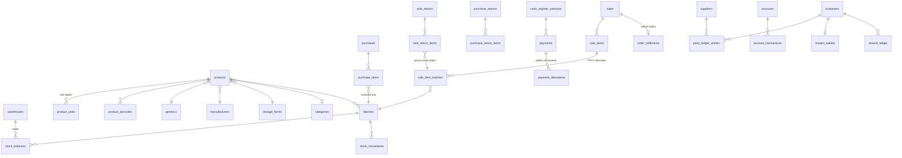

# Red Pharma: New Database Design (v0.1, draft for approval)

Each design choice here answers a defect found in the legacy schema (see `../database-dependencies.md`, `../known-issues.md`). Legacy problem → fix:

| Legacy problem | New design |
|---|---|
| Stock in 3–4 places, no ledger, 11,568 duplicate rows, drift | One append-only `stock_movements` ledger + one `stock_balances` projection with a UNIQUE key, updated in the same transaction under row lock |
| Batches unused, expiry on two columns | `batches` is mandatory for stock. Expiry lives only on the batch. FEFO and the expired-stock block are enforced in the service and checked by tests |
| Box/strip/piece only on reorder fields | `product_units` ladder per product. Lines store unit, factor and qty_base |
| `double` money, totals from the browser | `DECIMAL(14,2)` amounts, `DECIMAL(14,4)` unit prices/costs. Totals computed by the API |
| 8 FKs, no indexes on hot tables | FKs on every relation (`ON DELETE RESTRICT`), indexes designed for each query path |
| Duplicate reference numbers | `document_sequences` with row lock → gap-free `UNIQUE` document numbers |
| Hard deletes of financial rows | Documents are never deleted. `status=void` with reason, user and time. Master data uses soft delete |
| Magic integer statuses | Short `VARCHAR` enum codes backed by PHP enums, `CHECK` constraints where the engine supports them |
| Due computed differently per report | `party_ledger_entries` per customer and supplier. One rule for balances |
| Two loyalty ledgers | One `reward_ledger` + a `reward_wallets` projection |
| No generic names; "brand" = manufacturer; "category" = dosage form | Explicit `generics`, `manufacturers`, `dosage_forms`, `categories` (therapeutic or shop grouping) |

## 1. Conventions

- **Keys:**
  - `id BIGINT UNSIGNED AUTO_INCREMENT` on every table.
  - `ulid CHAR(26) UNIQUE` on documents exposed in URLs or receipts (sales, purchases, returns, payments, online orders).
  - FKs are `BIGINT UNSIGNED`, `ON DELETE RESTRICT ON UPDATE CASCADE`.
- **Timestamps:** `created_at`, `updated_at` (`TIMESTAMP(6)` on ledgers). `created_by`/`updated_by` FK → users where useful. Master data has `deleted_at` (soft delete). Documents and ledgers are never deleted.
- **Money:**
  - `DECIMAL(14,2)` for amounts.
  - `DECIMAL(14,4)` for unit price and unit cost.
  - `DECIMAL(14,3)` for quantities in a unit.
  - `INT` for `qty_base` (pieces). Base units are whole pieces; liquids and creams are sold per bottle or tube = 1 piece.
- **Single currency:** BDT, stored in settings. There is no currency column.
- **Enums:** `VARCHAR(20)` codes, documented per table.
- **Naming:** snake_case plural tables; pivot tables named `a_b`.
- **Legacy traceability:** imported rows get a `legacy_id` (nullable, indexed) so the ETL and the bridge can map ids. `legacy_id_map` covers cross-system mapping.
- **Engine:** InnoDB, `utf8mb4_unicode_ci`, strict SQL mode on.

## 2. Domain overview

## 3. Tables

### 3.1 Organization, settings, system

| Table | Key columns | Constraints / notes |
|---|---|---|
| `warehouses` | code, name, type(`store`,`warehouse`), address, phone, invoice_header, invoice_footer, is_active | UNIQUE(code). Replaces legacy warehouses **and** billers (billers become invoice header fields) |
| `settings` | scope(`global`,`warehouse`), scope_id, key, value JSON | UNIQUE(scope, scope_id, key). POS settings, near-expiry days, rounding, receipt layout, reward rules, SMS templates |
| `document_sequences` | doc_type, warehouse_id, year, prefix, next_number | UNIQUE(doc_type, warehouse_id, year). Locked `FOR UPDATE` on use → numbers like `S-DHK1-2026-000123` |
| `idempotency_keys` | key, user_id, endpoint, request_hash, response_code, response_body JSON, created_at | UNIQUE(user_id, key). Pruned after 7 days |
| `audit_logs` | user_id, action, subject_type, subject_id, before JSON, after JSON, ip, user_agent, created_at | INDEX(subject_type, subject_id), INDEX(user_id, created_at) |
| `legacy_id_map` | entity, legacy_id, new_id, source(`etl`,`bridge`) | UNIQUE(entity, legacy_id). Used by ETL and bridge |
| `bridge_watermarks` | job, last_legacy_id, last_run_at, status, error | UNIQUE(job) |
| `attachments` | attachable_type, attachable_id, disk, path, original_name, mime, size, uploaded_by | Private disk. Served through signed URLs only. MIME + extension allow-list |
| framework | `users` sessions, `jobs`, `failed_jobs`, `cache`, `personal_access_tokens`, `notifications` | Laravel defaults |

### 3.2 Identity and access

| Table | Key columns | Notes |
|---|---|---|
| `users` | name, username, email, phone, password, is_active, last_login_at, must_change_password, default_warehouse_id | UNIQUE(username), UNIQUE(email). Soft delete |
| `roles`, `permissions`, `role_has_permissions`, `model_has_roles`, `model_has_permissions` | spatie/laravel-permission standard | Proper `model_has_roles` (legacy used `users.role_id`) |
| `user_warehouses` | user_id, warehouse_id | PK(user_id, warehouse_id). Data scope for every query |
| `role_limits` | role_id, max_line_discount_pct, max_order_discount_pct, can_override_batch, can_sell_below_cost | Server-enforced discount limits per role |

### 3.3 Catalog

| Table | Key columns | Constraints / notes |
|---|---|---|
| `manufacturers` | name, short_name, country, is_active | UNIQUE(name). Legacy `brands` (362) maps here |
| `generics` | name, description | UNIQUE(name). e.g. "Paracetamol". Filled by data enrichment (O1) |
| `dosage_forms` | name | UNIQUE(name). Legacy `categories` (Tablet, Syrup, Injection…) maps here |
| `categories` | name, parent_id, slug, sort_order, is_active | Shop or therapeutic grouping (tree). Legacy top-level groups map here |
| `products` | sku (legacy `code`), name (brand name), generic_id NULL, strength (e.g. "10 mg"), dosage_form_id, manufacturer_id, category_id NULL, description, requires_prescription BOOL, is_batch_tracked BOOL default 1, is_active, reorder_level_base INT, reorder_qty_base INT, tax_rate_id NULL, image_path, slug, legacy_id | UNIQUE(sku), UNIQUE(slug), FULLTEXT(name, strength), INDEX(generic_id), INDEX(manufacturer_id), INDEX(dosage_form_id). Soft delete |
| `product_units` | product_id, unit_code(`piece`,`strip`,`box`,`bottle`,`tube`,`vial`,…), label, factor INT (pieces per unit), is_base, is_purchase_default, is_sale_default, sort_order | UNIQUE(product_id, unit_code); exactly one `is_base` with factor = 1 per product; factor > 0 |
| `product_barcodes` | product_id, product_unit_id NULL, barcode | **UNIQUE(barcode)** across the catalog. A scan resolves product **and** unit (box barcode vs strip barcode) |
| `price_lists` | code(`retail`,`wholesale`), name, is_default | Retail and wholesale price lists |
| `product_prices` | price_list_id, product_unit_id, price DECIMAL(14,4), effective_from, effective_to NULL, created_by | INDEX(product_unit_id, price_list_id, effective_from). Price history kept. The current price is the row with `effective_to IS NULL` |
| `tax_rates` | name, rate DECIMAL(5,2), is_inclusive | Legacy has none in use. Kept for future VAT |

### 3.4 Inventory

| Table | Key columns | Constraints / notes |
|---|---|---|
| `batches` | product_id, batch_no, expiry_date DATE NULL, mfg_date NULL, status(`active`,`quarantined`,`recalled`), is_legacy_opening BOOL | UNIQUE(product_id, batch_no). `expiry_date` is NULL **only** for `is_legacy_opening` batches (O2 fallback); a service rule forbids NULL otherwise. INDEX(product_id, expiry_date) for FEFO |
| `stock_balances` | warehouse_id, product_id, batch_id, qty_base INT, avg_unit_cost DECIMAL(14,4), updated_at | **UNIQUE(warehouse_id, batch_id)**, INDEX(warehouse_id, product_id), `CHECK (qty_base >= 0)`. Row-locked on every movement |
| `stock_movements` | warehouse_id, product_id, batch_id, qty_base INT (signed), type, unit_cost DECIMAL(14,4), source_type, source_id, source_line_id, reason, created_by, created_at(6) | Append-only, never updated. INDEX(product_id, created_at), INDEX(warehouse_id, created_at), INDEX(source_type, source_id). Types: `opening`, `purchase`, `purchase_return`, `sale`, `sale_return`, `adjustment`, `transfer_out`, `transfer_in`, `count`, `damage`, `expiry_writeoff` |
| `stock_adjustments` / `stock_adjustment_items` | number, warehouse_id, reason(`damage`,`expiry`,`correction`,`lost`,`found`), note, status(`draft`,`posted`,`void`), posted_by/at / product_id, batch_id, qty_base signed, unit_cost | Posting creates movements |
| `stock_counts` / `stock_count_items` | number, warehouse_id, scope (all / category / manufacturer), status(`open`,`counting`,`posted`,`cancelled`), started_by / product_id, batch_id, system_qty_base, counted_qty_base, difference | Posting creates `count` movements for the differences. Replaces the legacy CSV-file stock counts. Also used for the cutover count |
| `stock_transfers` / `stock_transfer_items` | number, from_warehouse_id, to_warehouse_id, status(`draft`,`sent`,`received`,`void`) / product_id, batch_id, qty_base | `sent` → `transfer_out`; `received` → `transfer_in` (in transit in between) |

**Invariants (tested):**
- Σ `stock_movements.qty_base` per (warehouse, batch) = `stock_balances.qty_base`.
- No balance < 0.
- A sale allocation never touches a batch where `expiry_date < sale date` or status ≠ `active`.

### 3.5 Parties

| Table | Key columns | Constraints / notes |
|---|---|---|
| `customers` | code, name, phone, phone_normalized, email, gender, date_of_birth NULL, customer_group_id NULL, credit_limit DECIMAL NULL, is_walk_in BOOL, is_active, notes, legacy_id | UNIQUE(phone_normalized) when not null, INDEX(name). One system "Walk-in customer" row. Soft delete |
| `customer_addresses` | customer_id, label, address_line, division, district, thana, is_default | For online orders |
| `customer_groups` | name, discount_pct DECIMAL(5,2) | |
| `suppliers` | code, name, company_name, phone, email, address, payment_terms_days, is_active, legacy_id | UNIQUE(code). Soft delete |
| `supplier_manufacturers` | supplier_id, manufacturer_id | Which supplier distributes which company (reorder drafts) |
| `party_ledger_entries` | party_type(`customer`,`supplier`), party_id, entry_date, type(`opening`,`invoice`,`payment`,`return`,`refund`,`adjustment`,`void`), debit DECIMAL(14,2), credit DECIMAL(14,2), source_type, source_id, note, created_by | Append-only. INDEX(party_type, party_id, entry_date). Balance = Σ(debit − credit). Customer due > 0 = customer owes; supplier credit > 0 = we owe |

### 3.6 Purchasing

| Table | Key columns | Constraints / notes |
|---|---|---|
| `purchases` | ulid, number, warehouse_id, supplier_id, supplier_invoice_no, invoice_date, received_at, status(`draft`,`received`,`void`), subtotal, discount_total, tax_total, other_charges, grand_total, paid_total, due_total, note, is_legacy, created_by, voided_by/at/reason | UNIQUE(number), INDEX(supplier_id, invoice_date), INDEX(warehouse_id, received_at). `supplier_id` is **required** (legacy had 2,488 NULL → mapped to an "Unknown supplier" row) |
| `purchase_items` | purchase_id, product_id, product_unit_id, qty DECIMAL(14,3), factor INT, qty_base INT, free_qty_base INT, batch_no, expiry_date, mfg_date NULL, unit_cost DECIMAL(14,4), discount, tax, line_total, batch_id (set on receive), retail_price_per_unit NULL | On `received`, the batch is found or created and a `purchase` movement is posted. Optional retail price update creates a `product_prices` row |
| `purchase_returns` / `purchase_return_items` | ulid, number, purchase_id NULL, supplier_id, warehouse_id, status(`posted`,`void`), totals / purchase_item_id NULL, product_id, batch_id, qty_base, unit_cost, line_total | Must return a specific batch. Stock check under lock |
| `reorder_drafts` / `reorder_draft_items` | number, supplier_id NULL, warehouse_id, source(`manual`,`low_stock`,`ai`), status(`draft`,`converted`,`discarded`), ai_run_id NULL / product_id, product_unit_id, suggested_qty, final_qty, sold_qty_period, in_stock_base, note | Replaces legacy `product_order_quantitys` + AI tables. "Convert" creates a draft purchase |
| `ai_runs` | type(`forecast`,`draft_orders`,`vision_search`), status, params JSON, result JSON, tokens_used, cost, started/finished_at, created_by | Audit and cost tracking of OpenAI use |

### 3.7 Sales and POS

| Table | Key columns | Constraints / notes |
|---|---|---|
| `cash_registers` | warehouse_id, name, is_active | Physical counters |
| `cash_register_sessions` | cash_register_id, opened_by, opened_at, opening_float, closed_by, closed_at, expected_cash, counted_cash, difference, status(`open`,`closed`), note | One open session per register (UNIQUE on register_id + generated `open_flag`). A POS sale requires the cashier's open session |
| `cash_movements` | session_id, type(`cash_in`,`cash_out`), amount, reason, created_by | Petty cash in/out at the till |
| `sales` | ulid, number, channel(`pos`,`manual`,`website`,`app`), warehouse_id, customer_id, cashier_id, session_id NULL, status(`held`,`completed`,`void`), sale_date, subtotal, line_discount_total, order_discount_type(`amount`,`percent`) NULL, order_discount_value, order_discount_total, tax_total, shipping_total, rounding, grand_total, paid_total, change_total, due_total, payment_status(`unpaid`,`partial`,`paid`), points_redeemed INT, points_value, points_earned INT, prescription_ref NULL, note, is_legacy, voided_by/at/reason, idempotency_key | UNIQUE(number), UNIQUE(ulid), INDEX(warehouse_id, sale_date), INDEX(customer_id, sale_date), INDEX(session_id), INDEX(status, sale_date). `held` = parked cart: no stock or ledger effect |
| `sale_items` | sale_id, line_type(`product`,`misc`), product_id NULL, product_unit_id NULL, description, qty, factor, qty_base, unit_price DECIMAL(14,4), price_source(`list`,`override`), discount_type, discount_value, discount_total, tax_total, line_total, cost_total DECIMAL(14,2) | `misc` lines (O3) have no product and no stock effect. `cost_total` captured at sale time for exact profit |
| `sale_item_batches` | sale_item_id, batch_id, qty_base, unit_cost DECIMAL(14,4), returned_qty_base | The FEFO allocation, one row per batch used. Returns reference these rows |
| `sale_returns` / `sale_return_items` | ulid, number, sale_id, customer_id, warehouse_id, session_id NULL, status(`posted`,`void`), refund_method(`cash`,`credit`,`account`), subtotal, total, reason, created_by / sale_item_batch_id, qty_base, unit_price, line_total, restock BOOL | Return qty ≤ sold − already returned (checked under lock). `restock=false` for damaged returns (posts a damage movement instead) |

### 3.8 Payments and finance

| Table | Key columns | Constraints / notes |
|---|---|---|
| `payment_methods` | code(`cash`,`card`,`bkash`,`nagad`,`rocket`,`bank`,`customer_credit`,`points`), name, account_id, is_active, requires_reference | Mobile wallets are first-class |
| `accounts` | code, name, type(`cash`,`bank`,`mobile_wallet`), account_no, opening_balance, is_default, is_active | |
| `payments` | ulid, number, direction(`in`,`out`), party_type NULL, party_id NULL, method_id, account_id, amount DECIMAL(14,2), reference, paid_at, session_id NULL, status(`posted`,`void`), note, created_by, idempotency_key | INDEX(party_type, party_id, paid_at), INDEX(session_id), INDEX(account_id, paid_at) |
| `payment_allocations` | payment_id, allocatable_type(`sale`,`purchase`,`sale_return`,`purchase_return`), allocatable_id, amount | Σ allocations ≤ payment amount. One customer payment can settle several invoices (due collection) |
| `account_transactions` | account_id, txn_date, direction(`in`,`out`), amount, source_type, source_id, note | Append-only. Account balance = opening + Σ in − Σ out |
| `money_transfers` | number, from_account_id, to_account_id, amount, transfer_date, note, created_by | Posts two account transactions |
| `expense_categories` / `expenses` | name, parent_id / number, warehouse_id, category_id, account_id, amount, expense_date, session_id NULL, note, attachment, status(`posted`,`void`) | |
| `income_categories` / `incomes` | same shape as expenses | |

### 3.9 Loyalty and membership

| Table | Key columns | Notes |
|---|---|---|
| `reward_settings` | (in `settings`) earn rule (points per BDT spent), point value, minimum redeem, expiry months, excluded categories | |
| `reward_ledger` | customer_id, type(`opening`,`earn`,`redeem`,`expire`,`adjust`,`reverse`), points INT signed, value DECIMAL, source_type, source_id, expires_at NULL, note, created_by, created_at | Append-only. INDEX(customer_id, created_at) |
| `reward_wallets` | customer_id, balance INT, lifetime_earned, lifetime_redeemed, updated_at | UNIQUE(customer_id). Projection updated with the ledger under lock |
| `membership_plans` | code, name, min_annual_spend, discount_pct, points_multiplier, fee, duration_months, is_active | |
| `membership_benefits` | plan_id, type, value, description | |
| `customer_memberships` | customer_id, plan_id, starts_at, ends_at, status(`active`,`expired`,`cancelled`), source(`auto`,`purchase`,`manual`), assigned_by | One active per customer |

### 3.10 Online orders and delivery

| Table | Key columns | Notes |
|---|---|---|
| `shipping_zones` | division, district, thana, rate, min_order_free_shipping, delivery_partner, is_active | Legacy 41 rows imported |
| `riders` | name, phone, nid, status, is_active | UNIQUE(phone) |
| `order_fulfilments` | sale_id (channel website/app), tracking_code, status(`pending`,`confirmed`,`packed`,`in_transit`,`delivered`,`cancelled`,`returned`), shipping_zone_id, address snapshot JSON, rider_id NULL, cod_amount, legacy_sale_id (bridge), status timestamps | UNIQUE(sale_id), UNIQUE(tracking_code). Stock is allocated **once**, at `confirmed`, and released on cancel (legacy deducted twice) |
| `order_status_history` | fulfilment_id, from_status, to_status, note, changed_by, changed_at | |

### 3.11 HR and payroll

| Table | Key columns | Notes |
|---|---|---|
| `departments`, `designations` | name | |
| `employees` | code, user_id NULL, name, phone, email, department_id, designation_id, join_date, basic_salary DECIMAL, is_active | Salary is **stored** (legacy never saved it) |
| `holidays` | date, name, warehouse_id NULL | UNIQUE(date, warehouse_id) |
| `attendances` | employee_id, date, check_in, check_out, status(`present`,`absent`,`leave`,`late`), note | UNIQUE(employee_id, date) |
| `salary_advances` | employee_id, amount, given_at, account_id, recovered_amount, status | Replaces legacy advances_payments |
| `payroll_runs` / `payslips` | period (YYYY-MM), status(`draft`,`approved`,`paid`) / run_id, employee_id, basic, additions, deductions, advance_recovery, net, paid_payment_id NULL | Paying a payslip posts a payment out (account transaction) |

## 4. Write paths (all in one DB transaction each)

| Operation | Locks | Writes |
|---|---|---|
| Complete POS sale | `document_sequences` row; `stock_balances` rows of the candidate batches (FOR UPDATE, ordered by id to avoid deadlocks); `reward_wallets` row if points are used | sales, sale_items, sale_item_batches, stock_movements(−), stock_balances, payments, payment_allocations, account_transactions, party_ledger_entries (invoice and payment; due if any), reward_ledger/wallet (redeem + earn), audit_logs, idempotency_keys |
| Receive purchase | sequence; balances of the target batches | batches (find/create), purchase_items.batch_id, stock_movements(+), stock_balances (qty + moving average cost), party_ledger_entries (supplier invoice), product_prices (optional) |
| Sale return | balances; the original sale_item_batches rows | sale_returns/items, stock_movements(+) or damage, party_ledger_entries/refund payment, reward reversal |
| Void sale | the sale row + balances | status=void, reversing stock_movements, reversing ledger entries; payments voided or turned into customer credit. Allowed only in the same open session, with the `sales-void` permission |

## 5. Indexing for the hot paths
- **Barcode scan:** `product_barcodes.barcode` UNIQUE → product + unit in one lookup.
- **POS search:** FULLTEXT(products.name, strength) + `generics.name`, plus prefix `LIKE 'abc%'` on `products.name` (INDEX(name)). Joined with `stock_balances` filtered by warehouse and `qty_base > 0`.
- **FEFO pick:** `stock_balances` (warehouse_id, product_id) → join `batches` ordered by expiry_date with the `(product_id, expiry_date)` index.
- **Reports:** `sales(warehouse_id, sale_date)`, `sale_items(product_id)`, `stock_movements(product_id, created_at)`, `party_ledger_entries(party_type, party_id, entry_date)`, `payments(account_id, paid_at)`.

## 6. What happens to legacy tables
See `data-migration-plan.md` §2 for the full table-by-table mapping. Dropped modules are exported to an `archive/` SQL dump and are not migrated.
