# WP3: Database architecture audit (Red Pharma POS)

**Scope:** production dump `u241572975_redpharma_app.sql` (phpMyAdmin export, dated 2026-03-10, MariaDB 11.8.3, dump:6-7), migrations in `backend - ocr pos/database/migrations` (207 files) plus `Modules/Manufacturing/Database/Migrations` (2 files), and models in `backend - ocr pos/app/Models` (104 files).
**Method:** I extracted only the CREATE TABLE and ALTER TABLE blocks. Row counts come from counting value tuples. A local Python parser computed integrity aggregates (counts only) over 37 tables. This document contains **no data rows or PII**.
**Path shorthand:** `dump:N` is a line in the SQL dump. `app/...` and `database/...` are relative to `backend - ocr pos/`.
**Confidence:** statements marked **UNVERIFIED** are inferred and were not proven from code or data.

---

## 0. Headline facts

| Fact | Value |
|---|---|
| Tables in dump | **94** (93 utf8mb4_unicode_ci and 1 utf8mb4_general_ci, all InnoDB) |
| Tables with data | 56. The other 38 are empty, including coupons, gift_cards, deliveries, transfers, product_variants, taxes, deposits, money_transfers, payment_with_* and quotations |
| Declared FOREIGN KEYs | **8** in the whole DB (dump:707871-707898) |
| Secondary indexes | ~27 in total. **None** on `sales`, `product_sales`, `payments`, `product_purchases`, `purchases`, `returns` or `product_batches` |
| Largest tables | product_sales ≈302.4k, payments ≈121.7k, sales ≈119.5k, product_purchases ≈65.1k, product_warehouse ≈36.4k, products ≈24.5k, product_order_quantitys ≈10.4k, purchases ≈8.5k |
| Data span | sales, payments and purchases run 2025-03 → 2026-03 |
| Warehouses / accounts / currencies in use | 1 / 1 / 1 (all sales have warehouse_id=1 and currency_id=3) |
| Migrations recorded in `migrations` | 212 rows (AUTO_INCREMENT 267). **6 migration files are not yet applied** (the 2026_08-09 membership, reward, AI and customer-auth work) and **13 applied migrations have no file** (WooCommerce, productions, purchase_product_return create) |

---

## 1. Table inventory

Legend:
- **Rows** are approximate tuple counts from the dump.
- **Idx** lists secondary indexes from the dump ALTER blocks.
- **FK** shows declared foreign keys. "conv." means implied by naming convention only.
- **Model** is the Eloquent class in `app/Models` unless noted.
- PK is `id` (int or bigint, AUTO_INCREMENT) unless noted.

### 1.1 Catalogue and stock

| Table | Purpose | Key columns | Rows | Idx | FK | Model |
|---|---|---|---|---|---|---|
| products | Product master. Its `qty` is a denormalised total of stock | code, name, type, category_id, brand_id, unit_id, sale_unit_id, purchase_unit_id, cost, price, wholesale_price, qty, box_qty, stripe_qty, piece_qty, alert_quantity, is_batch, is_variant, is_imei, is_active, expire_date, product_list/qty_list/price_list (combo, CSV) | 24,506 (AI 24,968) | idx_products_name, idx_products_qty, idx_products_brand_category. **No index or UNIQUE on `code`** | conv. only | Product |
| product_warehouse | Stock per product × warehouse × (batch) × (variant) | product_id, warehouse_id, product_batch_id, variant_id, qty, price, imei_number (CSV) | 36,421 | fk_product_warehouse_product(product_id) **only** | **products ON DELETE CASCADE ON UPDATE CASCADE** (dump:707898) | Product_Warehouse |
| product_batches | Batch/lot with expiry | product_id, batch_no, expired_date (NOT NULL), qty | 11 | none | conv. | ProductBatch |
| product_variants | Variant pivot holding variant stock | product_id, variant_id, item_code, additional_cost/price, qty | 0 | none | conv. | ProductVariant |
| variants | Variant names | name | 0 | – | – | Variant |
| categories | Category tree | name, parent_id, slug, woocommerce_category_id | 233 | idx_categories_name | conv. | Category |
| brands | Brand | title | 362 | idx_brands_title | – | Brand |
| units | Units of measure with conversion | unit_code, base_unit, operator (`*` or `/`), operation_value | 5 (Pc, dozen = 12 Pc, carton = 24 Pc, kg, g = kg/1000) | none | conv. | Unit |
| taxes | Tax rates | rate | 0 | – | – | Tax |
| adjustments / product_adjustments | Stock adjustment header and lines | warehouse_id, total_qty / product_id, variant_id, qty, action (+/-) | 30 / 95 | none | conv. | Adjustment / ProductAdjustment |
| stock_counts | Physical count sessions (CSV files) | warehouse_id, category_id (varchar CSV), brand_id (varchar CSV), initial_file, final_file, is_adjusted | 5 (none adjusted) | none | conv. | StockCount |
| transfers / product_transfer | Inter-warehouse transfer | from/to_warehouse_id, status / product_id, batch, variant, qty, purchase_unit_id | 0 / 0 | none | conv. | Transfer / ProductTransfer |
| product_order_quantitys | AI or manual re-order drafts per supplier and date | product_id, supplier_id, date, sold_qty, in_stock, order_qty, box_qty, stripe_qty, code/name/category (copied) | 10,418 (AI 31,754) | KEY product_id | – | **none** (accessed with DB::table, app/Http/Controllers/ReportController.php:357,512) |
| dso_alerts | Days-of-stock alert snapshots | product_info (longtext), number_of_products | 0 | – | – | none (app/Console/Commands/DsoAlert.php) |
| barcodes | Label sheet templates | – | 0 | – | – | Barcode |
| productions / product_productions | Manufacturing module | warehouse_id / production_id, product_id, qty | 0 / 0 | – | conv. | Modules/Manufacturing/Entities/Production, ProductProduction |

### 1.2 Sales side

| Table | Purpose | Key columns | Rows | Idx | FK | Model |
|---|---|---|---|---|---|---|
| sales | Invoice header for POS, web and manual sales | reference_no, sale_type enum(pos, website, manual), customer_id, warehouse_id, biller_id, user_id, cash_register_id, item, total_qty, total_discount, total_tax, total_price, order_tax, order_discount(_type/_value), coupon_id, coupon_discount, shipping_cost, grand_total, paid_amount, sale_status, payment_status, currency_id, exchange_rate | 119,542 | **none** (no index on reference_no, customer_id, created_at, warehouse_id) | conv. | Sale |
| product_sales | Sale lines | sale_id, product_id, product_batch_id, variant_id, qty, return_qty, sale_unit_id, net_unit_price, discount, tax_rate, tax, total, is_delivered, is_packing | 302,398 | **none** | conv. | Product_Sale |
| custom_product_sales | Ad-hoc lines for products not in the catalogue. The name and code are typed in at the POS | sale_id, product_name, product_code, qty, totals | 4,520 (on 3,334 sales) | none | conv. | CustomProductSale |
| returns / product_returns | Customer returns header and lines | sale_id, customer_id, account_id, grand_total / return_id, product_id, batch, qty, sale_unit_id | 2,080 / 3,985 | none | conv. | Returns / ProductReturn |
| quotations / product_quotation | Quotes | – | 0 / 0 | none | conv. | Quotation / ProductQuotation |
| deliveries | Delivery notes | sale_id, courier_id, packing_slip_ids (CSV), status | 0 | none | conv. | Delivery |
| packing_slips / packing_slip_products | Packing | sale_id, delivery_id / packing_slip_id, product_id, variant_id | 0 / 0 | none | conv. | PackingSlip / PackingSlipProduct |
| challans | Courier challans | courier_id, *_list (CSV longtext) | 0 | none | conv. | Challan |
| couriers | Couriers | – | 0 | – | – | Courier |
| order_trackings | Online order tracking | tracking_no (UNIQUE), sale_id, assigned_rider_id, current_status | 37 | UNIQUE tracking_no, sale_id, rider | **sales ON DELETE CASCADE, riders ON DELETE CASCADE** (dump:707885-6) | OrderTracking |
| order_tracking_histories | Tracking status log | tracking_id, status | 79 | tracking_id | **order_trackings CASCADE** | OrderTrackingHistory |
| riders | Delivery riders | phone (UNIQUE), nid (UNIQUE), status enum | 4 | 2 UNIQUE | – | Rider |
| shipping_zones | Delivery rates by division, district and thana | rate, min_order_amount, delivery_partner enum | 41 | none | – | ShippingZone |
| coupons | Coupons | code, type, amount, quantity, used, expired_date | 0 | **no UNIQUE(code)** | – | Coupon |
| gift_cards / gift_card_recharges | Stored value | card_no, amount, expense / gift_card_id | 0 / 0 | **no UNIQUE(card_no)** | conv. | GiftCard / GiftCardRecharge |
| discounts, discount_plans, discount_plan_customers, discount_plan_discounts | Discount engine | product_list (CSV), valid_from/till | all 0 | none | conv. | Discount, DiscountPlan, DiscountPlanCustomer, DiscountPlanDiscount |
| tables | Restaurant tables (unused) | – | 0 | – | – | Table |

### 1.3 Purchasing side

| Table | Purpose | Key columns | Rows | Idx | FK | Model |
|---|---|---|---|---|---|---|
| purchases | Purchase header | reference_no, bill_no, supplier_id (nullable), warehouse_id, grand_total, paid_amount, status, payment_status | 8,484 | none | conv. | Purchase |
| product_purchases | Purchase lines | purchase_id, product_id, product_batch_id, variant_id, qty, recieved, return_qty, purchase_unit_id, net_unit_cost, total | 65,115 (AI 122,713) | none | conv. | ProductPurchase |
| return_purchases / purchase_product_return | Returns to supplier | purchase_id, supplier_id, account_id / return_id, product_id, qty | 5 / 15 | none | conv. | ReturnPurchase / PurchaseProductReturn |
| suppliers | Suppliers | name, company_name, email, phone | 91 | none | – | Supplier |

### 1.4 Money

| Table | Purpose | Key columns | Rows | Idx | FK | Model |
|---|---|---|---|---|---|---|
| payments | Payments for both sales and purchases, polymorphic by nullable column | payment_reference, sale_id XOR purchase_id, account_id, cash_register_id, amount, change, used_points, paying_method | 121,748 | **none** | conv. | Payment |
| payment_with_cheque / _credit_card / _gift_card / _paypal | Payment-method details | payment_id + cheque_no / charge_id / gift_card_id / transaction_id | all 0 | none | conv. | PaymentWithCheque, PaymentWithCreditCard, PaymentWithGiftCard, PaymentWithPaypal |
| accounts | Cash or bank accounts | account_no, initial_balance, total_balance, is_default, type, parent_account_id, is_payment | 1 | none | – | Account |
| money_transfers | Transfers between accounts | from_account_id, to_account_id, amount | 0 | none | conv. | MoneyTransfer |
| expenses / expense_categories | Expenses | expense_category_id, warehouse_id, account_id, cash_register_id, amount | 285 / 16 | none | conv. | Expense / ExpenseCategory |
| incomes / income_categories | Other income | same shape as expenses | 18 / 10 | none | conv. | Income / IncomeCategory |
| cash_registers | Till sessions | user_id, warehouse_id, cash_in_hand, status | 3 (all open, status=1) | none | conv. | CashRegister |
| deposits | Customer deposits (wallet) | customer_id, amount | 0 | none | conv. | Deposit |
| currencies | Currencies | exchange_rate | 1 | – | – | Currency |

### 1.5 Parties, loyalty and auth

| Table | Purpose | Key columns | Rows | Idx | FK | Model |
|---|---|---|---|---|---|---|
| customers | Customers and e-commerce accounts | customer_group_id, phone_number, email, password (e-com), points, deposit, expense, is_active, customer_type, district, plus ad-hoc columns (`ecom`, `dsf`, `admin`, `assigned`, `aaaaaaaa`, …) | 733 | **none** (no UNIQUE on phone or email) | conv. | Customer (HasApiTokens) |
| customer_groups | Price group (% discount) | percentage (varchar) | 1 | – | – | CustomerGroup |
| account_removal_requests | Customer account-deletion requests | user_id (points to **customers**) | 0 | KEY | **customers CASCADE** | AccountRemovalRequest |
| billers | Biller (store front) | – | 12 | – | – | Biller |
| warehouses | Stores | – | 1 | – | – | Warehouse |
| reward_point_settings | Legacy earn rule: 1 point per X spent | per_point_amount, minimum_amount, duration, type | 1 | – | – | RewardPointSetting |
| reward_point_tiers | Tier table (legacy) | min_points, max_points, discount_rate, deduction_* | 3 | – | – | RewardPointTier |
| reward_point_usages | Legacy redemptions | customer_id, order_id (sale), tier_id | 0 | 3 KEYs (FK-named, but **no constraint**) | – | RewardPointUsage |
| users | Staff, plus supplier and online-order logins | email, password, role_id, biller_id, warehouse_id, supplier_id, is_active, is_deleted | 87 | **none (migration declares UNIQUE email, which is missing in prod)** | conv. | User (Spatie HasRoles) |
| roles / permissions / role_has_permissions | Spatie RBAC, keyed through `users.role_id` | – | 7 / 155 / 266 | composite PK on role_has_permissions | **No FKs** (the migration declares them) | Roles; Spatie |
| personal_access_tokens | Sanctum tokens, customer app only | tokenable_type, tokenable_id, token UNIQUE, expires_at | 148 (all for Customer, all with expires_at NULL) | UNIQUE token, morph index | – | Sanctum |
| password_resets | Staff password reset | email | 3 | email | – | – |
| notifications | Laravel notifications | morph | 0 | morph index | – | – |

### 1.6 HR, settings and misc

| Table | Rows | Notes | Model |
|---|---|---|---|
| employees / departments / attendances / holidays / payrolls / hrm_settings | 1 / 1 / 1 / 1 / 4 / 1 | HRM module, effectively unused | Employee, Department, Attendance, Holiday, Payroll, HrmSetting |
| advances_payments | 4 | 3 FKs to employees and users | AdvancesPayment |
| general_settings | 1 | without_stock='no', decimal=2, modules='manufacturing', is_packing_slip=1 | GeneralSetting |
| pos_setting | 1 | **No PK**, only UNIQUE(id). Holds Stripe and PayPal key columns (values not inspected) | PosSetting |
| mail_settings | 1 | Holds an SMTP password column (value not inspected) | MailSetting |
| external_services | 9 | Integration config in longtext (credentials likely) | ExternalService |
| languages | 1 | **No PK, no AUTO_INCREMENT** | Language |
| translations, sms_templates, custom_fields, currencies | 0/0/0/1 | – | Translation, SmsTemplate, CustomField, Currency |
| failed_jobs, migrations | 0 / 212 | Framework tables | – |

### 1.7 Models with no table in prod (code-only)

These models expect tables that do not exist in the production dump. Any code path that touches them throws `SQLSTATE 42S02` until the pending migrations run.

| Model | Expected table | Created by migration |
|---|---|---|
| Country | `countries` | **none** |
| Product_Supplier | `product_supplier` | **none** (imported in ProductController.php:31) |
| CustomerMembership, CustomerMembershipProfile, MembershipBenefit, MembershipHistory, MembershipPayment, MembershipPlan, MembershipRenewal, MembershipSetting, MembershipTransaction, MembershipUpgradeHistory, MembershipUpgradeRequest | `membership_*` and `customer_membership*` | 2026_08_05_100000, 2026_08_05_100001 (**not applied**) |
| RewardWallet, RewardTransaction, RewardExpiryBatch, RewardRedemption, RewardAdjustment, RewardCampaign, RewardCampaignRule, RewardSetting | `reward_*` | 2026_08_06_140000 (**not applied**) |
| AI draft-order runs and batches (service code) | `ai_order_generation_runs` / `_batches`, plus `product_order_quantitys.generation_source` and `.generation_run_id` | 2026_09_23_000001 (**not applied**) |
| AuthenticationService | `customer_password_resets`, plus `customers.normalized_phone`, `.normalized_email` and `.identity_source` | 2026_08_05_000001 (**not applied**) |

Two relations point at things that do not exist:
- `Sale::hasMany(SaleWarrantyGuarantee)` (app/Models/Sale.php). There is no such class or table.
- `Supplier::hasMany(Product)`. `products` has no `supplier_id`.

---

## 2. Core domain relationship map

All relationships are **convention only** unless marked [FK]. Only the [FK] edges are enforced by the database.

```mermaid
erDiagram
  categories ||--o{ products : category_id
  brands ||--o{ products : brand_id
  units ||--o{ products : "unit_id / sale_unit_id / purchase_unit_id"
  units ||--o{ units : base_unit
  taxes ||--o{ products : tax_id
  products ||--o{ product_variants : product_id
  variants ||--o{ product_variants : variant_id
  products ||--o{ product_batches : product_id
  products ||--o{ product_warehouse : "product_id [FK CASCADE]"
  warehouses ||--o{ product_warehouse : warehouse_id
  product_batches ||--o{ product_warehouse : product_batch_id
  customers }o--|| customer_groups : customer_group_id
  customers ||--o{ sales : customer_id
  billers ||--o{ sales : biller_id
  warehouses ||--o{ sales : warehouse_id
  users ||--o{ sales : user_id
  cash_registers ||--o{ sales : cash_register_id
  coupons ||--o{ sales : coupon_id
  currencies ||--o{ sales : currency_id
  sales ||--o{ product_sales : sale_id
  sales ||--o{ custom_product_sales : sale_id
  products ||--o{ product_sales : product_id
  product_batches ||--o{ product_sales : product_batch_id
  units ||--o{ product_sales : sale_unit_id
  sales ||--o{ payments : sale_id
  purchases ||--o{ payments : purchase_id
  accounts ||--o{ payments : account_id
  cash_registers ||--o{ payments : cash_register_id
  payments ||--o| payment_with_cheque : payment_id
  payments ||--o| payment_with_credit_card : payment_id
  payments ||--o| payment_with_gift_card : payment_id
  payments ||--o| payment_with_paypal : payment_id
  gift_cards ||--o{ payment_with_gift_card : gift_card_id
  gift_cards ||--o{ gift_card_recharges : gift_card_id
  sales ||--o{ returns : sale_id
  returns ||--o{ product_returns : return_id
  accounts ||--o{ returns : account_id
  suppliers ||--o{ purchases : supplier_id
  purchases ||--o{ product_purchases : purchase_id
  products ||--o{ product_purchases : product_id
  product_batches ||--o{ product_purchases : product_batch_id
  purchases ||--o{ return_purchases : purchase_id
  return_purchases ||--o{ purchase_product_return : return_id
  accounts ||--o{ money_transfers : "from_account_id / to_account_id"
  accounts ||--o{ expenses : account_id
  expense_categories ||--o{ expenses : expense_category_id
  accounts ||--o{ incomes : account_id
  customers ||--o{ deposits : customer_id
  adjustments ||--o{ product_adjustments : adjustment_id
  transfers ||--o{ product_transfer : transfer_id
  warehouses ||--o{ transfers : "from_warehouse_id / to_warehouse_id"
  sales ||--o{ deliveries : sale_id
  sales ||--o{ packing_slips : sale_id
  sales ||--o| order_trackings : "sale_id [FK CASCADE]"
  riders ||--o{ order_trackings : "assigned_rider_id [FK CASCADE]"
  order_trackings ||--o{ order_tracking_histories : "tracking_id [FK CASCADE]"
  customers ||--o{ reward_point_usages : customer_id
  sales ||--o| reward_point_usages : order_id
  reward_point_tiers ||--o{ reward_point_usages : tier_id
  roles ||--o{ users : role_id
  roles ||--o{ role_has_permissions : role_id
  permissions ||--o{ role_has_permissions : permission_id
  customers ||--o{ personal_access_tokens : "tokenable (morph)"
  suppliers ||--o{ product_order_quantitys : supplier_id
  products ||--o{ product_order_quantitys : product_id
```



### Notes on the map

- **Online orders** are not a separate table. They are `sales` rows with `sale_type='website'`, `sale_status=0` and `payment_status=0` (app/Http/Controllers/Api/OrderController.php:56-74). There are 27 such rows. Stock is deducted at order time (OrderController.php ~111-128). Tracking is in `order_trackings`.
- **Payments are polymorphic by nullable column.** Each row has `sale_id` XOR `purchase_id`, and the data confirms it: 0 rows have both and 0 have neither. A returns refund posts against `returns.account_id`, not `payments`.
- **Membership and reward engine (new):** `customers` → `reward_wallets` → `reward_transactions`, `reward_expiry_batches`, `reward_redemptions` and `reward_adjustments`, plus `customer_membership_profiles` → `customer_memberships` → `membership_plans`. All of these are declared with real FKs in the 2026 migrations, but **none exist in prod yet**.
- **AI tables:** `ai_order_generation_runs` → `ai_order_generation_batches` (via run_id), linked to `product_order_quantitys.generation_run_id`. **Not in prod.**
- **RBAC:** `users.role_id` → `roles` → `role_has_permissions` → `permissions`. Checks call `Role::findById(role_id)->hasPermissionTo(...)`, plus a hard bypass `Auth::user()->role_id <= 2` (app/Http/Controllers/SaleController.php:95). The Spatie `model_has_roles` and `model_has_permissions` tables were created by the 2018 migration but are **absent from prod** and unused.

---

## 3. How stock is represented

### 3.1 Where quantity lives (three or four places, all denormalised and updated imperatively)

| Store | Grain | Written by |
|---|---|---|
| `products.qty` | Total stock per product across all warehouses, in **base units** | SaleController.php:1475, PurchaseController.php:423, SaleController.php:3474 (sale edit restore), SaleController.php ~4782 (sale delete) |
| `product_warehouse.qty` | Per product × warehouse × optional batch × optional variant | SaleController.php:1497, PurchaseController.php:427-436 |
| `product_batches.qty` | Per product × batch_no. **Warehouse-agnostic** | SaleController.php:1490, PurchaseController.php:353-366 |
| `product_variants.qty` | Per product × variant (warehouse-agnostic) | SaleController.php:1479 |

**There is no stock ledger or movement table.** History can only be reconstructed by replaying the purchases, sales, returns, adjustments and transfers line tables. There is no `lockForUpdate` and no transaction on the POS sale path: the `DB::beginTransaction()` in `SaleController::store` is commented out (SaleController.php:1155). Every update is a read-modify-write `->qty -= x; ->save()`, so concurrent tills can lose updates.

**Measured drift (aggregates from the dump):**
- `products.qty ≠ Σ product_warehouse.qty` for **2,591 products** (10.6%).
- 19 products have no product_warehouse row.
- 26 products and 25 product_warehouse rows have qty < 0, even though `without_stock='no'`.
- **11,568 (product, warehouse, batch, variant) keys are duplicated in product_warehouse, accounting for 11,923 surplus rows.**

The duplicates matter because the lookup scope returns any row matching product and warehouse, and the code calls `->first()`:

```php
// app/Models/Product_Warehouse.php:23-29
public function scopeFindProductWithoutVariant($query, $product_id, $warehouse_id)
{ return $query->where([['product_id',$product_id],['warehouse_id',$warehouse_id]]); }
```

As a result, a sale decrements an arbitrary one of the duplicate rows, which can be a batch row. Meanwhile, stock screens that SUM over product_warehouse see the total. 33,038 of the 36,421 product_warehouse rows have NULL `created_at`, which suggests they were bulk-inserted by an import. **UNVERIFIED:** the import path that created the duplicates.

### 3.2 Batch and expiry

- A batch lives in `product_batches(product_id, batch_no, expired_date NOT NULL, qty)`.
- Purchases find or create the batch by (product_id, batch_no), overwrite `expired_date` and add qty (PurchaseController.php:352-366).
- The batch is linked to stock through `product_warehouse.product_batch_id` and to lines through `product_sales`, `product_purchases`, `product_returns`, `product_transfer` and `purchase_product_return` (`.product_batch_id`).
- **In practice batches are almost unused.**
  - `products.is_batch` is NULL for all 24,506 products.
  - There are only 11 batch rows, all expired before the dump date, plus 11 product_warehouse batch rows and 9 product_purchases rows with a batch.
  - **0 product_sales rows carry a batch.** Pharmacy FEFO and expiry tracking therefore does not exist in the data.
- `products.expire_date` is a parallel, product-level expiry column. It is not in any migration (only in `2025_03_08_003250_add_expire_date_to_products.txt`, which is not a .php file and was never run). It is non-null on only 3 products. The Excel import sets it to 2999-12-31 (ProductController.php:1358).
- Bugs on the batch path:
  - **Sale delete decrements the batch instead of restoring it:** `$lims_product_batch_data->qty -= $product_sale->qty;` (SaleController.php:4775). The matching sale-edit restore correctly uses `+=` (SaleController.php:3468).
  - On a non-batch purchase, the lookup in PurchaseController.php:417-420 matches any row for product and warehouse, including batch rows, and then sets `product_batch_id = null` on it (PurchaseController.php:429). This silently converts a batch row into a non-batch row.

### 3.3 Variants

- `products.is_variant` is NULL everywhere. `product_variants` and `variants` are empty, and no product_warehouse or product_sales row has a variant_id. **Variants are unused.**
- The code path, when used: `ProductVariant::FindExactProductWithCode` resolves `item_code` to a variant (SaleController.php:1462). Stock is held in `product_variants.qty` and in `product_warehouse` (variant_id).
- Combo products store their components as CSV in `products.product_list` and `qty_list` (SaleController.php:1424-1450). There are no combo products (`type='standard'` for all).

### 3.4 Units and pack conversion

- `units` are related through `base_unit`, `operator` and `operation_value`. Base quantity is `qty * operation_value` when `operator='*'` and `qty / operation_value` when `operator='/'`. This applies at sale (SaleController.php:1470-1473), purchase (PurchaseController.php:345-347) and sale edit (SaleController.php:3448-3451).
- Line tables store the **entered** qty plus `sale_unit_id` or `purchase_unit_id`. Stock tables store **base** qty.
- **In prod every product uses unit 1 (`Pc`) for unit, sale and purchase. All product_sales rows use sale_unit_id=1, and 65,113 of 65,115 purchase lines use unit 1** (2 use kg). Effectively all quantities are pieces.
- **Pack fields (pharmacy-specific, not in migrations):** `products.box_qty`, `stripe_qty` and `piece_qty` are decimal(10,2). Product create and edit write them (ProductController.php:445-447, 1034-1036), and bulk update writes them too (ProductController.php:1640-1650). They are **not** used by stock movement. They are read only by the re-order and AI draft logic:
  - `stripesPerBox = products.stripe_qty` and `piecesPerStripe = products.piece_qty` (app/Services/OpenAI/AiDraftOrderGenerationService.php:158-163; resources/views/backend/report/order_qty_alert_report.blade.php:370-380).
  - Order qty in pieces is `box × stripe_qty × piece_qty`.
  - The meaning of `products.box_qty` itself (possibly a default order size) is **UNVERIFIED**.
  - Populated on 8,520 products (box), 3,173 (stripe) and 8,518 (piece).
- The pack hierarchy is therefore **not** modelled in `units`. Box, strip and piece selling at the POS is not supported by the schema.

### 3.5 Other stock movers
- **Adjustments:** `product_adjustments.action` ∈ {+, −}, with 62 `+` and 33 `−`.
- **Stock counts:** file-based and never adjusted.
- **Transfers:** none.
- **Returns:** `product_returns` add stock back. `product_sales.return_qty` is set on 3,945 lines.

---

## 4. How money is represented

All money columns are **`double`**: sales, payments, purchases, accounts, expenses and customers.deposit/expense. The exceptions are a few `decimal` columns in HR, shipping and the new 2026 tables. Expect rounding drift.

| Concept | Stored | Derived / how computed |
|---|---|---|
| Sale totals | `sales.total_price`, `order_tax`, `order_discount`, `coupon_discount`, `shipping_cost`, `grand_total` are **all stored** and come from the client form | `grand_total = total_price + order_tax − order_discount − coupon_discount + shipping`. The formula holds except for 27 rows (the website orders). `total_price ≠ Σ product_sales.total` on **18,639 sales**, partly explained by custom_product_sales on 3,334 sales. **UNVERIFIED:** the remaining cause (likely line discounts or custom lines). `sales.item ≠ count(lines)` on 2,911 sales, and 452 sales have no product_sales lines (445 of them are custom-only) |
| paid_amount | `sales.paid_amount` is **stored and incremented** on addPayment (SaleController.php:3978) | Should equal Σ `payments.amount` for the sale. It mismatches on **64 sales**. 212 sales have no payment row, and 10 payments point to missing sales |
| payment_status | `sales.payment_status` is **stored**. Codes are 1 Pending, 2 Due, 3 Partial, 4 Paid (SaleController.php:559-566). The POS sets 2 when `balance ≠ 0`, otherwise 4 (SaleController.php:1196-1201). Partial is never set by the POS | Distribution: 4 = 119,385, 2 = 130, 0 = 27 (web). 37 rows are inconsistent with paid vs grand_total, and 4 are overpaid |
| sale_status | Codes 1 Completed, 2 Pending, 3 Draft, 4 Returned, 5 Processing (SaleController.php:538-557), plus 0 for web orders | 1 = 118,750, 4 = 708, 3 = 57, 0 = 27 |
| Customer due | **Derived on read**: `grand_total − Σ returns.grand_total − paid_amount` per sale (CustomerController.php:278, ReportController.php:7006-7013). Some reports omit returns (ReportController.php:4052) | Inconsistent formulas across reports. Completed-sale outstanding ≈ 43.3k (currency units) by the stored columns |
| Customer deposit / wallet | `customers.deposit` and `customers.expense` are **stored running totals**, adjusted on deposit CRUD (CustomerController.php:662,692,703) and on payment by deposit (SaleController.php:1637, 4097). Balance = deposit − expense (CustomerController.php:671) | `deposits` table is empty and all customers have deposit = 0 |
| Reward points (legacy) | `customers.points` is **stored**: incremented by `int(grand_total / per_point_amount)` on sale (SaleController.php:1302-1306) and decremented on redemption (1641, 4107). `payments.used_points` | 373 customers have points > 0, and 0 payments use points. The new `reward_wallets.available_points` engine (app/Services/Rewards/RewardEngine.php) is a **second ledger**. I found no migration step that seeds wallets from `customers.points` (**UNVERIFIED**) |
| Supplier due | **Derived**: `grand_total − paid_amount` per purchase (SupplierController.php:58). `purchases.payment_status` 1 = Due, 2 = Paid (PurchaseController.php:864) | paid_amount matches Σ payments for all purchases. 6,079 purchases are Due and 2,488 purchases have a NULL supplier_id |
| Accounts | `accounts.initial_balance` and `total_balance` are stored. The balance shown is recomputed from payments, returns and transfers plus initial_balance (AccountsController.php:120) | 1 account. **2,397 payments have `account_id=0`** (no such account) |
| Expenses / incomes | `amount` is stored, with account_id and cash_register_id | 285 / 18 rows |
| Cash register | `cash_in_hand` is stored at open. Totals are derived from payments by `cash_register_id` | 77,712 payments (64%) and 75,420 sales have a NULL cash_register_id. 3 registers are open and none closed |
| Payment method | All 121,748 payments are `paying_method='Cash'` | payment_with_* tables are empty |
| Change | `payments.change` is stored as `paying_amount − paid_amount` (SaleController.php:1603) | Always 0 in the data |
| References | `reference_no` / `payment_reference` are built as `date("Ymd")-date("his")`, which has second resolution and a 12-hour clock (SaleController.php:1190, 1600, 4013) | **511 duplicate `sales.reference_no` and 508 duplicate `payment_reference`.** The `his` format repeats AM and PM within the same day |

---

## 5. Drift and integrity

### 5.1 Migrations vs dump: tables

- **In the dump, with no `Schema::create` in any migration file (13 tables):**
  - account_removal_requests, advances_payments, custom_product_sales, order_trackings, order_tracking_histories, product_order_quantitys, reward_point_tiers, reward_point_usages, riders, shipping_zones.
  - Framework tables: personal_access_tokens, permissions and role_has_permissions. The Spatie ones come from 2018_06_03_053738 via config names. There is no `config/permission.php` or `config/sanctum.php` in the repo (vendor defaults apply).
  - These were created by hand or by migrations that have since been deleted.
- **In the dump with a migration row but no file (13 rows):** WooCommerce columns (2023_03_*, 2023_08_*), the productions tables (the files live in Modules), `2018_12_26_144210_create_purchase_product_return_table`, `2021_10_23_142451_add_is_approve_to_payments_table` (the column `is_approve` is **not** in the dump), `2023_02_05_132001_add_change_to_payments_table` and `2025_01_10_145926_add_columns_to_products_table`.
- **In migrations but not the dump (pending):** the 6 files from 2026_08_05 to 2026_09_23, covering membership (13 tables), the reward engine (8), AI (2), `customer_password_resets` and the `product_sales_product_date_unit_idx` index.
  - Also `model_has_roles` and `model_has_permissions`: the migration ran, but the tables are gone from prod.
- Two migration files have a `.txt` extension and never run: `2025_02_13_165106_add_name_and_is_default_to_languages_table.txt` and `2025_03_08_003250_add_expire_date_to_products.txt`.

### 5.2 Migrations vs dump: columns (script diff; may have small false positives)

| Table | In dump, not in migrations | In migrations, not in dump |
|---|---|---|
| products | box_qty, stripe_qty, piece_qty, expire_date, slug, is_sync_disable, woocommerce_product_id, woocommerce_media_id | – |
| customers | password, gender, avator, card_number, arabic_name, customer_type, customer_assigned_to, assigned, admin, ecom, dsf, franchise_location, district, `aaaaaaaa` | normalized_phone, normalized_email, identity_source (pending) |
| sales | sale_type (enum), woocommerce_order_id | – |
| returns | order_discount_type, order_discount_value, order_discount | – |
| purchases | bill_no | – |
| payments | change | is_approve (the migration ran, but the column is absent) |
| categories | slug, bg_color, woocommerce_category_id, is_sync_disable | – |
| adjustments | user_id | – |
| payrolls | present, absent, holiday, weekend, total_*, salary, addition, advance, deduction, designation | – |
| employees | salary | – |
| taxes | woocommerce_tax_id | – |
| users | supplier_id | UNIQUE(email) |
| languages | language, name, is_default | code |
| product_order_quantitys | entire table | generation_source, generation_run_id (pending) |

**Conclusion:** the migrations folder **cannot rebuild prod**. Any fresh environment built from migrations differs materially from prod. The dump schema is the source of truth.

### 5.3 Missing FKs and indexes on hot paths (production)

Only 8 FKs exist, and none covers the core sale, purchase or payment chain. Hot lookups are unindexed (full scans on 100k-300k-row tables):

| Hot lookup (code) | Missing index |
|---|---|
| `product_sales.sale_id` (every invoice view and return) | INDEX(sale_id) |
| `product_sales(product_id, created_at)` (reports, AI re-order) | Pending migration index `product_sales_product_date_unit_idx` |
| `payments.sale_id`, `payments.purchase_id`, `payments.cash_register_id` | INDEX each |
| `sales.reference_no`, `sales.customer_id`, `sales.created_at`, `sales(warehouse_id, created_at)`, `sales.cash_register_id` | INDEX, plus UNIQUE on reference_no (blocked by 511 duplicates) |
| `product_warehouse(product_id, warehouse_id, product_batch_id, variant_id)` | Composite index. Uniqueness is blocked by 11,568 duplicate keys |
| `products.code` (barcode scan) | UNIQUE(code). **0 duplicates today, so it is safe to add** |
| `product_batches(product_id, batch_no)` | UNIQUE (0 duplicates) |
| `product_purchases.purchase_id`, `product_returns.return_id`, `returns.sale_id`, `purchases.supplier_id` | INDEX |
| `customers.phone_number` (POS lookup, auth) | INDEX. 18 duplicate phones; the pending migration handles them with a normalized_phone that keeps the first occurrence |
| `users.email` | UNIQUE (declared by the migration, missing in prod) |
| `coupons.code`, `gift_cards.card_no` | UNIQUE (tables are empty, so safe) |

### 5.4 Nullability, orphans and integrity problems found in data

- **Orphans:**
  - 643 product_sales rows and 219 product_purchases rows reference **non-existent products**. About 462 products were hard-deleted (AI 24,968 vs 24,506 rows), and the CASCADE on product_warehouse deleted their stock rows silently.
  - 10 payments reference missing sales. 5 custom_product_sales sale_ids are orphans.
  - 2,397 payments have `account_id=0`.
- **Zero prices:** price ≤ 0 on 15,359 products and cost ≤ 0 on 15,361 (63%). Five products are priced below cost. **UNVERIFIED** whether these are placeholder or inactive SKUs (747 products are inactive).
- **Nullable FKs:** `purchases.supplier_id` (2,488 NULL), `sales.biller_id` (27 NULL), `sales.cash_register_id` and `payments.cash_register_id` (majority NULL), `customers.is_active` (39 NULL), `products.tax_method` (3,390 NULL).
- **Type mismatches:** `stock_counts.category_id` and `brand_id` are varchar (CSV). `customer_groups.percentage` is varchar. CSV-in-column appears in `products.product_list/qty_list/price_list/variant_list`, `product_warehouse.imei_number`, `deliveries.packing_slip_ids`, `challans.*_list` and `discounts.product_list`.
- **ID width mismatch:** FK-ish columns are `int(11)` signed while PKs are `int(10) UNSIGNED`. Real FKs cannot be added without an ALTER of the column type first. Example: `product_warehouse.product_id` was changed to int(10) for its FK.
- **No PK:** `languages`, `password_resets` and `pos_setting` (pos_setting has UNIQUE id only).
- **Status codes are magic ints** with no lookup table, and the meanings differ between sales and purchases (see §4).

### 5.5 Soft-delete conventions (mixed)

| Entity | Convention |
|---|---|
| products | `is_active=false` on destroy (ProductController.php ~1903). Yet 462 products were hard-deleted at some point, through another path or by hand (**UNVERIFIED**) |
| customers | `is_active=false` (CustomerController.php:724) |
| users | Both `is_active` and `is_deleted` (24 have is_deleted=1) |
| sales, purchases, returns, payments, product_* lines | **Hard delete** (SaleController.php:4695-4797, PurchaseController.php:1826-1900). Stock is restored imperatively, and deleting a sale cascades to order_trackings through the FK |
| Membership tables (new) | Laravel `SoftDeletes` (`deleted_at`) on CustomerMembership and MembershipPlan |
| No `deleted_at` exists in any production table | – |

### 5.6 Duplicated or denormalised data

- Stock is held in 3 or 4 places (§3.1).
- Customer dues and status are stored on sales (paid_amount and payment_status) but derived in reports.
- Loyalty has two ledgers: `customers.points` (live) and `reward_wallets` (pending).
- `product_order_quantitys` copies `code`, `name` and `category` from products.
- `custom_product_sales` keeps free-text product names and codes, with no link to products.
- `products.expire_date` duplicates `product_batches.expired_date`.
- `sales.item` and `total_qty` duplicate line aggregates.
- Supplier logins sit in `users` (`role_id=6`, 67 users; `users.supplier_id`), alongside the `suppliers` table. **UNVERIFIED:** whether role 6 is actually used for supplier logins.

### 5.7 Security-relevant schema observations (no values inspected)

- `pos_setting` holds Stripe and PayPal key columns, `mail_settings` holds an SMTP password column, and `external_services.details` likely holds API credentials. All are stored in plaintext columns.
- `customers.password` holds e-commerce logins in a POS table.
- `personal_access_tokens` has 148 Customer tokens, all with `expires_at` NULL, and there is no `config/sanctum.php`, so tokens never expire.
- **Cascades that destroy data:**
  - `product_warehouse → products ON DELETE CASCADE` erases stock history on a product delete.
  - `order_trackings → sales CASCADE`.
  - `account_removal_requests → customers CASCADE`.

---

## 6. Business-critical dependencies and rules for future migrations

### 6.1 Critical dependencies (break these and POS money or stock breaks)

1. **The sale path** writes `sales`, then `product_sales` (or `custom_product_sales`), then `products.qty`, `product_warehouse.qty` and optionally `product_batches.qty`, then `payments`, then `customers.points`, `customers.expense` and `gift_cards.expense`. None of it is transactional (SaleController.php:1152-1660).
2. `units.operator` and `operation_value` convert every line qty to base qty. Changing unit rows rewrites the meaning of historical lines.
3. `Product_Warehouse::FindProductWithoutVariant(...)->first()` depends on there being **one** row per (product, warehouse). Duplicates corrupt stock silently.
4. Reports compute dues from `grand_total`, `paid_amount` and `returns.grand_total`. Do not change the semantics of `paid_amount`. `payments.amount` excludes change, which is stored separately in `payments.change` (SaleController.php:1603).
5. Status integer codes are hard-coded in controllers and Blade views.
6. The customer app (Sanctum `personal_access_tokens` with tokenable Customer) and the `customers.password` column carry live logins.
7. `general_settings.without_stock='no'` gates POS product lists to rows with stock (SaleController.php:2005-2055).
8. The AI re-order flow reads `product_sales`, `product_warehouse`, `products.box_qty`, `stripe_qty` and `piece_qty`, and writes `product_order_quantitys`.

### 6.2 Rules for any future migration (non-destructive only)

1. **Never drop, rename or retype an existing column or table** in prod. Use add-only migrations guarded by `Schema::hasTable` and `Schema::hasColumn`, as 2026_08_05_000001 does. Keep legacy columns (`customers.points`, `products.expire_date`, the pack fields) until a verified backfill and cut-over exist.
2. **Baseline first.** Generate a schema-only "squash" migration from the prod dump (`php artisan schema:dump` against a prod clone) so fresh environments match prod. Commit the 13 hand-made tables as `if (!Schema::hasTable)` migrations, and rename or remove the two `.txt` migration files deliberately.
3. **Clean data before adding a constraint**, in this order:
   - **a.** Dedupe `product_warehouse`: merge qty into one row per key, keeping an audit copy table, then add INDEX and later UNIQUE(product_id, warehouse_id, product_batch_id, variant_id). Note that NULLs do not collide in a MariaDB UNIQUE index, so use generated columns `COALESCE(x,0)` for uniqueness.
   - **b.** Reconcile `products.qty` to `Σ product_warehouse.qty` with a logged report, not a silent overwrite.
   - **c.** Re-key the duplicate `reference_no` and `payment_reference` values only by appending a suffix, never by changing financial values.
4. **Add indexes before FKs.** Index-only migrations are safe and online in MariaDB 11.8: `ALGORITHM=INPLACE, LOCK=NONE`. Priority: product_sales(sale_id), product_sales(product_id, created_at, sale_unit_id), payments(sale_id), payments(purchase_id), sales(customer_id), sales(created_at), sales(reference_no), product_purchases(purchase_id), product_returns(return_id), returns(sale_id), product_warehouse(product_id, warehouse_id), UNIQUE products(code), UNIQUE product_batches(product_id, batch_no).
5. **FKs:** first align column types (`int(11)` signed to `int(10) unsigned`) on a staging clone. Add FKs as **ON DELETE RESTRICT**, never CASCADE, after the orphans are resolved: 643 + 219 product lines, 10 payments and account_id=0. Consider replacing the existing `product_warehouse` CASCADE FK with RESTRICT.
6. **Never hard-delete financial or stock rows.** Introduce `deleted_at` (nullable, add-only) or status-based voiding for sales, purchases, payments and returns before changing delete code.
7. **Money:** do not convert `double` to `decimal` in place on live tables. Add shadow `decimal(14,2)` columns if needed, backfill, compare, then switch reads.
8. **Loyalty cut-over:** before enabling the reward engine, write an idempotent opening-balance migration from `customers.points` into `reward_wallets` and `reward_transactions` (type `opening`), and freeze writes to `customers.points` afterwards.
9. **Pending 2026 migrations:** run them on a prod clone first. 2026_08_05_000001 adds UNIQUE normalized_phone and normalized_email with first-wins dedupe; 18 duplicate phones will get NULL. Check that the 148 customer tokens still resolve.
10. **Every migration needs:** a working `down()`, a dry run on a fresh prod dump, row-count and checksum comparisons before and after on sales, product_sales, payments and product_warehouse, and a scheduled low-traffic window. Take backups and keep them for at least 30 days.

---

## Appendix A: integrity aggregates (dump 2026-03-10)

| Check | Result |
|---|---|
| products.code duplicates | 0 |
| product_warehouse duplicate keys / surplus rows | 11,568 / 11,923 |
| products.qty ≠ Σ product_warehouse.qty | 2,591 |
| Negative stock: products / product_warehouse | 26 / 25 |
| product_warehouse rows with qty = 0 | 25,508 |
| Batch rows / expired / used on sales | 11 / 11 / 0 |
| Sales duplicate reference_no | 511 |
| Payments duplicate payment_reference | 508 |
| sales.paid_amount ≠ Σ payments | 64 |
| Sales without any payment | 212 |
| Sales with no product_sales lines | 452 |
| Orphan product_sales.product_id / product_purchases.product_id | 643 / 219 |
| Payments with account_id = 0 | 2,397 |
| Payments with NULL cash_register_id | 77,712 |
| Products with price ≤ 0 | 15,359 |
| Purchases with NULL supplier | 2,488 |
| Customers with duplicate phone | 18 |
| Top single customer share of sales | 118,152 of 119,542 (a walk-in default customer; **UNVERIFIED** name not inspected) |
